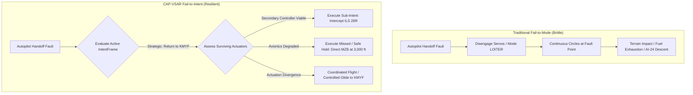
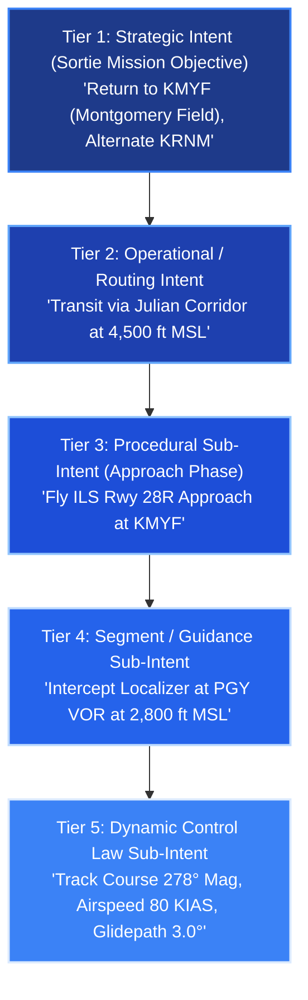
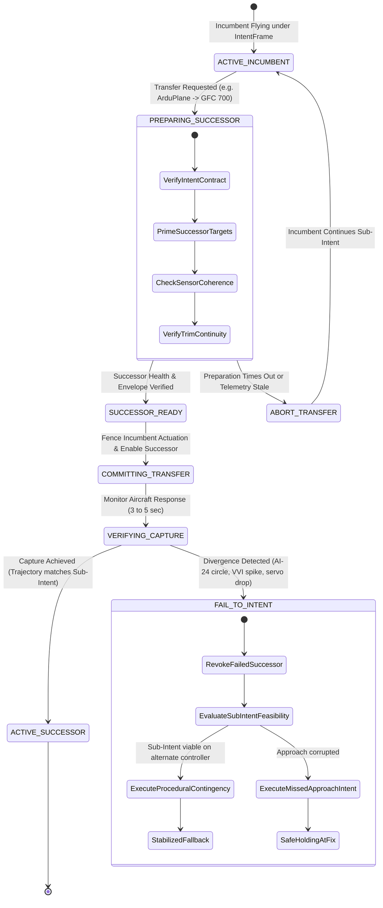

# Architectural Specification: "Fails to Intent" in Flight Control Handoffs

**Author:** DeepMind Agent (Antigravity) & Ron  
**Project:** CAP V-SAR (Civil Air Patrol Virtual Search and Rescue)  
**Status:** Conceptual Design & System Architecture  
**Target Platform:** Cessna 182T NAV III (CAP 487) / X-Plane 12 / ArduPilot SITL / GFC 700  

---

## 1. Executive Summary & Conceptual Definition

### What is "Fails to Intent"?
In traditional aerospace and autopilot systems, failure handling is governed by **Fail-to-Mode** semantics:
* **Fail-Passive / Fail-Neutral:** Disengages automation, levels/neutralizes surfaces, and drops control to the human pilot.
* **Fail-to-Loiter / Fail-to-Hold:** Latches into an arbitrary orbit or maintains current altitude/heading at the point of failure.
* **Fail-to-Pause:** Freezes simulation physics via a watchdog (an engineering tool, not a flight behavior).

While Fail-to-Mode prevents violent surface runaways in an inhabited cockpit with an alert human pilot, it is **catastrophic for unattended autonomous flight, multi-agent operations, and realistic SAR simulation**. When an autonomous aircraft drops control over mountainous terrain, or orbits indefinitely until fuel exhaustion because an autopilot handoff faulted, the system has avoided a control divergence only to succumb to a mission catastrophe.

> [!IMPORTANT]
> **Definition: Fails to Intent**  
> **Fails to Intent** is an architectural paradigm where any control handoff failure, subsystem fault, or automation degradation resolves to the **highest-priority safe action that preserves the authorized mission objective (intent)**, rather than collapsing into an uncoordinated control mode.
> 
> If a handover from ArduPlane to the GFC 700 faults during descent into San Diego, the system does not circle blindly at the point of fault; it executes the authorized fallback intent: **"Return to KMYF — Fly ILS Rwy 28R approach"** using whichever degraded or redundant actuation path remains viable.



---

## 2. The Problem in Current CAP-VSAR Handoffs

Recent flight trials and architecture reviews in `cap-vsar` exposed the vulnerability of mode-centric handoffs:

1. **The ArduPlane Leg 3 Failure (AI-24):**
   ArduPlane accepted GUIDED commands (`MAV_CMD_GUIDED_CHANGE_HEADING`), but its inner loops defaulted to loiter. The aircraft flew continuous left circles and descended $4,616 \to 2,974\text{ ft}$. The system had no awareness of whether this mode satisfied the sortie intent (transit to target), blindly treating "holding LOITER mode" as an acceptable running state until the gate's lower altitude boundary was violated.
2. **The GFC 700 Autopilot Toggle Trap:**
   The G1000 AP engagement command (`sim/GPS/g1000n1_ap`) is a toggle. When `sitl_lifecycle.py` attempted to park the aircraft on the GFC 700 during a handoff session, it toggled an already active autopilot *off*, plunging the aircraft into an unmonitored $1,200\text{ fpm}$ descent.
3. **The Direct Backend Slew Discontinuity:**
   When `XPlaneDirectBackend` disengages or releases, setting neutral surfaces and 0.45 throttle on an out-of-trim aircraft imposes immediate transient upset.
4. **The Gate Isolation Paradox:**
   `ManeuverGate` enforces an airborne box (3,000–6,000 ft MSL, 90–140 KIAS). When a parameter slips outside (e.g., speed drops to 89 KIAS during approach), the gate pauses the simulation or revokes the lease. The aircraft is frozen, but no intent is served.

---

## 3. The Hierarchy of Intent (The Intent Tree)

Intent is inherently hierarchical. Lower-level tactical intents exist solely to satisfy higher-level strategic intents.



### Tier Definitions

| Tier | Level | Example | Failure Behavior (Fails to Intent) |
|---|---|---|---|
| **Tier 1** | **Strategic Intent** | "Sortie B: Recover at KMYF with minimum 45 min fuel reserve" | If KMYF is socked in or closed, divert to Alternate (KRNM). Never loiter to dry tanks. |
| **Tier 2** | **Operational Intent** | "Transit Julian $\to$ Mission Valley at 4,500 ft MSL" | If terrain clearance or weather blocks route, reroute via VFR corridor at MEA. |
| **Tier 3** | **Procedural Sub-Intent** | "Fly the ILS Rwy 28R approach" | If ILS signals or glidepath coupling fail, transition to Localizer-only (LOC) minimums or Missed Approach. |
| **Tier 4** | **Segment Intent** | "Intercept LOC at PGY at 2,800 ft MSL" | If overshoot occurs, establish wings level on $250^\circ$, re-intercept from outside. |
| **Tier 5** | **Control Law Intent** | "Track $278^\circ$, maintain 80 KIAS, capture 3° GS" | If GFC 700 servos trip, direct backend or ArduPlane maintains pitch-for-airspeed and wings level. |

---

## 4. Formal Data Model: The `IntentFrame`

To implement "Fails to Intent", every flight executive step and control handoff must be accompanied by an immutable, verified **`IntentFrame`**. Controllers are not granted raw control of heading and altitude without an active contract defining what the aircraft is trying to achieve and how to fail safely.

```python
from dataclasses import dataclass, field
from enum import Enum
from typing import List, Optional, Tuple

class FlightPhase(str, Enum):
    TAKEOFF = "TAKEOFF"
    ENROUTE_TRANSIT = "ENROUTE_TRANSIT"
    SEARCH_PATTERN = "SEARCH_PATTERN"
    APPROACH_TRANSIT = "APPROACH_TRANSIT"
    TERMINAL_APPROACH = "TERMINAL_APPROACH"
    FINAL_LANDING = "FINAL_LANDING"
    MISSED_APPROACH = "MISSED_APPROACH"
    EMERGENCY_DIVERT = "EMERGENCY_DIVERT"

@dataclass(frozen=True)
class ContingencyPlan:
    """Explicit branch if the primary intent cannot be executed."""
    fallback_phase: FlightPhase
    clearance_altitude_ft: float
    target_fix: str
    target_fix_coords: Tuple[float, float]
    holding_course_mag: float
    max_holding_minutes: float
    divert_airport_icao: str

@dataclass(frozen=True)
class ProceduralSubIntent:
    """The immediate operational task, e.g., 'Fly ILS 28R'."""
    procedure_name: str                  # e.g., "ILS_28R_KMYF"
    nav_source: str                      # "NAV1" (VHF Localizer) or "GPS"
    nav_frequency_mhz: float             # 110.50 MHz
    inbound_course_mag: float            # 278.0 degrees
    decision_altitude_msl_ft: float      # 623.0 ft (200 ft AGL at KMYF)
    missed_approach: ContingencyPlan

@dataclass(frozen=True)
class IntentFrame:
    """Top-level intent contract bound to every control grant."""
    intent_id: str
    strategic_destination: str           # "KMYF"
    alternate_destination: str           # "KRNM"
    current_phase: FlightPhase
    primary_intent: str                  # "Return to KMYF"
    sub_intent: ProceduralSubIntent
    minimum_safe_altitude_ft: float      # Sector MSA / Terrain floor
    bingo_fuel_lbs: float                # Hard floor before divert
    authorized_controllers: List[str]    # ["GFC700", "DIRECT_BACKEND", "ARDUPLANE"]
```

---

## 5. The Intent-Preserving Handoff Protocol

When transferring control between execution engines (e.g., from ArduPlane transit to GFC 700 terminal approach), the handoff follows a stateful transaction. The fundamental rule of Fails-to-Intent is: **if a transfer fails, the system executes the Contingency Sub-Intent rather than an arbitrary mode fallback.**



### Transaction Steps & Failure Branches

1. **Step 1: Validate Intent Compatibility (`PREPARING`)**
   * Before touching actuators, verify that the successor controller is capable of executing the active `ProceduralSubIntent`. (e.g., GFC 700 cannot fly without valid NAV1 ILS signal; ArduPlane cannot fly without converged EKF3).
   * *Failure Action:* Incumbent retains command. No control handoff is attempted.
2. **Step 2: Actuator Fencing & Boundary Transfer (`COMMITTING`)**
   * Isolate the incumbent's UDP/actuator socket.
   * Verify trim continuity: read current elevator trim and initialize successor slew limiters from the trimmed state.
3. **Step 3: Verification of Capture (`VERIFYING`)**
   * The successor is granted authority, but monitored against the `IntentFrame` tracking limits (e.g., bank $\le 25^\circ$, cross-track error reducing, pitch within bounds).
4. **Step 4: The "Fails to Intent" Trigger**
   * If the successor fails verification (e.g., GFC 700 toggles off or ArduPlane enters an uncommanded circle as in Leg 3):
     * **Do not** leave the aircraft circling or descending.
     * **Do not** dump controls into MANUAL with floating trim.
     * **Execute Contingency Sub-Intent:**
       * Transition to `MISSED_APPROACH` or `EMERGENCY_DIVERT`.
       * Engage the tertiary direct flight controller (`services/ai_pilot/direct_backend.py`).
       * Pitch for climb airspeed (speed-on-pitch at 80 KIAS), add full power, climb to `clearance_altitude_ft` (e.g., 3,000 ft MSL), and navigate direct to `target_fix` (e.g., Mission Bay VOR `MZB`).

---

## 6. Case Study: The KMYF Recovery & ILS Approach

Consider a concrete CAP-VSAR mission scenario demonstrating the difference between classical mode failure and Fails-to-Intent:

### Scenario Context
* **Mission:** CAP 487 returning to Montgomery Field (KMYF) after an ELT homing mission east of Ramona.
* **Aircraft State:** 4,500 ft MSL, 110 KIAS, descending inbound to KMYF over Mission Valley.
* **Current Controller:** ArduPlane SITL in GUIDED mode.
* **Planned Transition:** Hand over to simulated GFC 700 to couple with the KMYF ILS Runway 28R.

```
                  [KMYF Rwy 28R]
                         ^
                         |  Final Approach Course 278°
                         |
                 (POBIK Fix) 1,800 ft
                         ^
                         |  Glidepath Intercept
                         |
                  (PGY VOR) 2,800 ft MSL <--- HANDOFF POINT
                         ^
                         |  ArduPlane Transit
                         |
                 [Descent from Julian]
```

---

### Comparison of Failure Responses

#### Classical Fail-to-Mode Behavior
1. At PGY VOR, the launcher stops SITL, clears overrides, and presses `g1000n1_ap`.
2. The G1000 AP fails to engage because NAV1 was set to GPS mode instead of VLOC.
3. Servos do not engage. `servos_on` remains 0.
4. Launcher exits with: "Handoff complete, parked on GFC 700".
5. **REALITY:** Aircraft is in unmanaged, untrimmed glide. Speed increases past 150 KIAS ($V_{ne}$ danger). Aircraft impacts terrain in Kearny Mesa.
6. **RESULT:** Catastrophic Loss of Aircraft.

#### Fail-to-Intent Behavior (With IntentFrame)
1. **Active IntentFrame:**
   * Strategic: "Recover KMYF"
   * Sub-Intent: "Fly ILS 28R (Freq 110.5, Course 278°, Dec Alt 623 ft)"
   * Contingency: "Climb 3,000 ft on 278°, direct MZB, hold west"
2. At PGY VOR, handoff initiated to GFC 700.
3. Verification Watchdog checks: "Did GFC 700 capture APR mode within 4s?"
4. **CHECK FAILS:** G1000 AP reports NAV invalid.
5. **FAIL-TO-INTENT ACTIVATES:**
   * Abort ILS approach coupling.
   * Fallback to Direct Backend: Set pitch $+7^\circ$ (80 KIAS), throttle 1.0.
   * Steer heading $278^\circ$ Mag (runway heading).
   * Climb to 3,000 ft MSL (safe obstacle clearance over San Diego).
   * Announce on virtual radio net: *"CAP 487 executing missed approach, autopilot coupling lost, proceeding MZB at 3,000 ft."*
6. **RESULT:** Aircraft Safe, Controlled, and Positioned for Re-Approach.

---

## 7. Integration with the CAP-VSAR Architecture

To realize Fails-to-Intent across the codebase, four components must be integrated:

### 1. The Intent Supervisor (`services/ai_pilot/intent_supervisor.py`)
A central state machine that owns the current `IntentFrame`. It mediates between crew/agent commands and low-level controllers:
* Receives task requests from the Mission Observer / Flight Planner / Crew (e.g. "Fly creeping line", "Return to base").
* Translates requests into verified `IntentFrame` contracts with explicit contingency plans.
* Grants authority leases to specific backends (`GFC700`, `ArduPlane`, or `DirectBackend`).

### 2. Upgraded ManeuverGate (`services/ai_pilot/maneuvers.py`)
Replace the static `Limits` with **Intent-Driven Phase Envelopes**:
* When `IntentFrame.current_phase == TERMINAL_APPROACH`, the minimum airspeed floor dynamically relaxes from 90 KIAS to 65 KIAS, and the AGL floor relaxes from 1,000 ft to Decision Height (200 ft AGL).
* Envelope violations do not blind-pause the simulation; they trigger the `IntentFrame.sub_intent.missed_approach` contingency!

### 3. Virtual Pilot Power & Configuration Daemon
Because the GFC 700 lacks an autothrottle, the Intent Supervisor coordinates a virtual flight engineer:
* On ILS approach sub-intent: automatically schedules flaps ($10^\circ \to 20^\circ \to 30^\circ$) at distance milestones and modulates throttle ratio to hold $80\text{ KIAS} \to 65\text{ KIAS}$.
* On missed approach intent: immediately commands throttle $1.0$, flaps $10^\circ$, and positive rate climb.

### 4. Direct Backend as the Universal Intent Anchor
`XPlaneDirectBackend` serves as the "universal survival controller". Because it drives surfaces directly with calibrated PID loops, autotrim, and speed-on-pitch, it does not rely on third-party SITL processes or simulated Garmin avionics states. If GFC 700 or ArduPlane fails, the Direct Backend can always execute the intent's basic wings-level climb and heading hold.

---

## 8. Summary Comparison

```
+-------------------------------------------------------------------------------+
|                      TRADITIONAL vs. FAIL-TO-INTENT                           |
+-------------------------------------------------------------------------------+
| Metric               | Fail-to-Mode (Old)          | Fails to Intent (New)   |
+----------------------+-----------------------------+-------------------------+
| Failure Primitive    | Mode string (LOITER, PAUSE) | IntentFrame contract    |
| Unattended Autonomy  | Impossible (requires pilot) | Fully Autonomous        |
| Handoff Divergence   | Circling / Spiral Dive      | Executed Missed Approach|
| Power Management     | Ignored / Assumed Manual    | Virtual Pilot Autothrottle
| Ground / Approach    | Blocked by Gate Envelope    | Phase-Specific Envelopes|
| Radio / Net Comms    | Silent                      | Automated Intention Call|
+-------------------------------------------------------------------------------+
```

---

## 9. Implementation Roadmap

1. **Step 1: Define `IntentFrame` Schema:** Implement the dataclasses in `services/ai_pilot/intent.py`.
2. **Step 2: Update `ManeuverGate`:** Allow the gate to evaluate telemetry against the active `IntentFrame` rather than a fixed 90 KIAS / 3,000 ft MSL block.
3. **Step 3: Build the Missed-Approach Direct Controller:** Wire `DirectBackend` to fly an automated missed approach profile ($V_y$ climb on runway track to clearance altitude) when triggered.
4. **Step 4: Re-evaluate ArduPlane Handoff (AI-24):** Ensure that if ArduPlane enters uncommanded loiter during transit, the Intent Supervisor detects progress failure against the active waypoint, revokes the lease, and triggers recovery intent.

