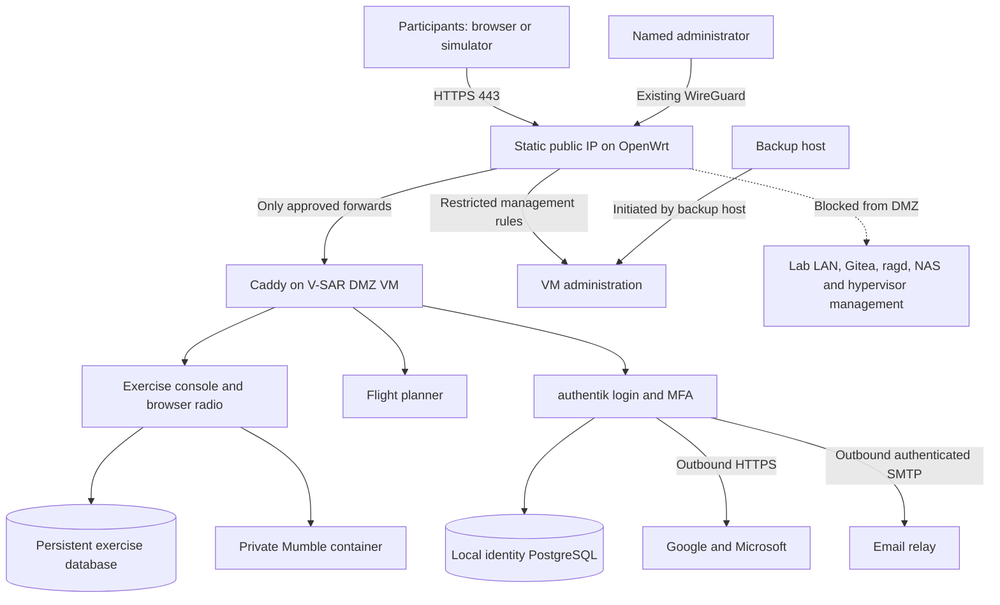

# V-SAR lab-hosted pilot plan

Date: 2026-09-09. Status: preferred hosting plan, replacing the proposed initial Cloud Run deployment. Planning only: no router, DNS, server, credentials or participant invitations changed.

## 1. Decision and scope

Use the existing lab hardware and the owner's static public IP/gigabit internet connection to validate demand before buying cloud hosting. Host the participant portal, exercise console, flight planner, identity/MFA, database and browser radio locally. Keep the Google Cloud design and cost estimate as a future migration option.

Initial release: invitation-only, 25 participants, three aircraft, one live exercise at a time, five 8-hour exercise days. X-Plane, XPPython3, Air Manager and PilotEdge remain on participant computers. Browsers and simulator plugins connect over public HTTPS; ordinary participants do not need a VPN. Site/infrastructure administration remains private.

All identity and authorization requirements in `WEB_HOSTING_AND_IDENTITY_PLAN.md` Sections 2 and 4–7 still apply. Hosting locally reduces infrastructure charges; it does not reduce the authentication work needed before opening the site to the internet.

## 2. What we know and must verify

- The owner confirms a static public IP and gigabit service. Existing router documentation records `203.0.113.10`; verify that actual address before DNS changes. No DDNS service is required for a confirmed static address.
- Documentation identifies a GL-MT6000 OpenWrt router, existing router-terminated WireGuard on UDP 51820, and a GCP site-to-site peer. Preserve them. Verify firmware, firewall engine, interface names and VLAN capabilities live before generating device-specific commands; do not paste old fw3 or DSA examples blindly.
- Existing V-SAR runs as Docker Compose on `ms01` (`192.0.2.151`). The as-built records substantial spare resources but is not a current capacity measurement. That machine also serves unrelated lab workloads/NFS.
- Existing documentation records native Mumble port forwards on TCP/UDP 64738. Inspect actual forwards, public IPv6 exposure, WAN management, and other users of ports 80/443 before modifying anything.
- Confirm sustained internet upload, latency under load, ISP hosting/port restrictions, disk headroom, hypervisor availability, UPS coverage and an off-host backup destination. A gigabit label alone does not establish upload performance or availability.

## 3. Isolated deployment topology

Create a dedicated VM named `vsar-pilot` on an existing virtualization host, with a single guest network interface in a new V-SAR DMZ VLAN. Suggested starting allocation: 4 vCPU, 8 GiB RAM, 80 GiB SSD-backed storage. Confirm capacity first. If virtualization is unavailable, use a dedicated spare host on an isolated physical router/switch port. Containers on the shared LAN host alone are not the preferred boundary.

An example subnet is `198.51.100.0/24`, VM `.10`; these addresses are placeholders pending an overlap check against LAN, WireGuard, site-to-site and other VLANs. The hypervisor's management interface stays in the management LAN. Do not dual-home the VM into the trusted LAN, pass through host storage, or mount the shared Docker socket/NFS exports.



Run Caddy, the exercise/radio service, flight planner, authentik server/worker and local PostgreSQL in version-pinned containers. Use separate service users, secrets, databases and Docker networks. PostgreSQL is required for identity. Application SQLite can remain on a persistent volume for the single-worker pilot with consistent backups; migrate it later through a database abstraction rather than blocking this pilot on Cloud SQL portability.

Do not start multiple exercise workers while state remains process-local. Persist/reconstruct active exercise metadata and use a documented safe stop/restart path; postpone multi-instance deployments. The planner may retain its own persistent aviation-data store. Give downloaded charts and exports bounded persistent storage with retention, not unlimited writes.

## 4. OpenWrt firewall and ingress policy

The DMZ is a real separate VLAN/firewall zone, not the consumer-router feature that forwards every port to a “DMZ host.” OpenWrt documents separate VLAN/zone isolation; exact implementation depends on the installed platform. [OpenWrt DMZ guidance](https://openwrt.org/docs/guide-user/firewall/fw3_configurations/fw3_dmz)

| Source → destination | Allowed traffic | Policy |
|---|---|---|
| WAN → V-SAR Caddy | TCP 443 | Public portal, login, browser radio and scoped plugin API. |
| WAN → V-SAR Caddy | TCP 80 | HTTP redirect and ACME validation only; no application login over HTTP. |
| WAN → router WireGuard | Existing UDP 51820 listener | Preserve the current configuration; never forward this port to the VM. |
| Named admin VPN peers/management station → VM | SSH and specifically required management endpoints | Source-specific rules; ordinary participant VPN peers do not inherit this access. |
| DMZ → LAN, management, other VLANs, VPN/site-to-site ranges | None by default | Block lateral access, including router UI, Gitea, ragd, NAS, NFS and hypervisor. Cover actual routed ranges and IPv6, not just RFC1918 IPv4. |
| DMZ → router | Required DNS/DHCP/NTP only, if provided there | Router management is denied. Static VM addressing can eliminate DHCP. |
| DMZ → WAN | Required HTTPS, authenticated SMTP and time/DNS paths | Deny other outbound ports initially; document permitted dependencies. No blanket LAN forwarding. |
| Trusted backup/deployment host → VM | Narrow pull-backup/push-deploy path | Keys and permissions scoped to the task; established replies allowed. VM cannot initiate sessions back into the lab. |

Disable automatic port creation for the DMZ. Ensure Docker-published ports are filtered by the guest/hypervisor/router path; do not assume the host's UFW policy controls Docker forwarding. In the new deployment publish only Caddy's 80/443; PostgreSQL, exercise 8700, planner 8080/8090, authentik backend ports and Caddy administration stay internal. Use loopback/private management bindings only where necessary.

IPv6: either implement equivalent inbound/outbound policy and verify it externally before publishing AAAA records, or leave the pilot hostname IPv4-only and explicitly prevent unintended direct public IPv6 service access. IPv4 NAT does not protect IPv6.

If another service already owns public 80/443, integrate hostname routing at one trusted existing ingress or plan a controlled ingress move. Do not overwrite forwards and break another site. Keep OpenWrt LuCI and SSH off the WAN.

Before any network mutation: export router configuration, record existing routes/forwards/peers, verify a local recovery path and use a timed rollback where supported. Make additive narrow changes. Test that WireGuard, the GCP tunnel and unrelated lab services still work.

## 5. DNS, HTTPS and service names

Proposed names, pending domain ownership/configuration checks:

- `vsar.rpc-cyberflight.com`: portal, exercise console, radio and plugin API.
- `auth.vsar.rpc-cyberflight.com`: authentik public login endpoints.
- `planner.vsar.rpc-cyberflight.com`: authenticated flight planner, with its own OIDC client/session cookie if using a separate origin.

Set public A records to the verified static IP. Use split DNS inside the lab so the same names resolve to the DMZ ingress, or test hairpin NAT if split DNS is unavailable. Google/Microsoft callbacks use the same canonical public HTTPS names from all networks.

Caddy obtains and renews trusted public certificates; preserve its data volume. This replaces the current internal-CA/IP-address setup for public participants. Keep login, APIs and browser microphones on HTTPS/WSS. Caddy documents automatic certificate renewal and HTTP redirects. [Caddy automatic HTTPS](https://caddyserver.com/docs/automatic-https)

If inbound port 80 is unavailable, validate an appropriate alternate ACME challenge. DNS-01 needs narrowly scoped DNS credentials; do not expose the router admin interface to obtain certificates. Avoid changing participant browser certificate trust stores.

Serve public authentik authentication endpoints while restricting identity administration to a tested private management path and privileged identity policy. Validate path/API restrictions against the installed version; a different hostname alone is not an admin access boundary.

## 6. Sign-in, MFA and invitations

Retain authentik Open Source with Google, Microsoft (personal and work/school), and local username/password accounts. Prove the exact flows without an Enterprise license in staging. TOTP codes have no per-login delivery fee; email requires a working relay. Do not host a new inbound mail server in the lab just to send invitations.

Participant experience: receive an email or QR invitation → sign in or create account → verify invited email → enroll/complete the second step → accept the exercise assignment → test audio → join the assigned station. Authenticator apps are recommended; email codes are allowed only for the lower-assurance participant policy. Instructor/platform-admin roles require an authenticator app. Provider login must not bypass that requirement.

Use expiring, cryptographically random, single-use invitations with hashed tokens and atomic POST acceptance. GET requests/email scanners do not consume them. Match verified recipient identity, enforce role delegation, and revoke old links on resend. Returning users see only their assigned exercises. Remove membership and revoke active sockets/device credentials within the proposed 30-second target.

Keep platform administrators separate from exercise instructors. Instructors use the public application with MFA for normal exercise management; router/VM/identity administration still requires private access. Callsigns, aircraft, channels and permissions come from server-side membership.

Local passwords and TOTP secrets live only in the identity service. Keep passwords, reset/MFA codes, provider secrets and session credentials out of logs and Git. Provide recovery codes; password/email recovery must not silently reset privileged MFA. Maintain two named administrators.

The original plan contains source-backed identity configuration details, assurance distinctions and recovery requirements. They are unchanged by the hosting location.

## 7. Existing application changes required before opening 443

1. Remove the `ADMIN`/`INSTRUCTOR` login shortcut and predictable role-code logins; production authorization must deny missing configuration.
2. Add server-side OIDC sessions, Secure/HttpOnly host-only cookies, CSRF protections and redirect validation; retire URL-carried role/session secrets.
3. Enforce exercise membership on every read/write/download and both state/voice WebSocket paths. Origin validation alone is insufficient.
4. Restrict planner exports and updates using caller permissions; stop letting ordinary requests act through a global instructor credential.
5. Scope radio channels/ICS and plugin telemetry/truth access to the assigned exercise/aircraft. Preserve the PTT watchdog and fail closed on expiry/disconnect.
6. Pair simulators with individual revocable device credentials. Plugins initiate outbound HTTPS; no inbound participant-PC port forwards or shared instructor keys.
7. Issue replacement invitations and invalidate legacy sessions/codes at cutover. Rotate old shared credentials without copying them into the new public environment.

These are launch gates, not optional post-launch hardening. Recheck the current code because other project changes may have addressed some findings since review.

## 8. Radio and bandwidth

Keep the current browser PCM-to-Mumble bridge for the pilot. All browser radio sessions use the authenticated HTTPS site, and Mumble need not have a public listener for those sessions. Raise the current default 16-browser-session cap only after a 25-session load test.

At 48 kHz mono 16-bit, one received stream is 0.768 Mbit/s. Twenty-five listeners receiving continuously require about 19.2 Mbit/s outbound payload, or approximately 23 Mbit/s with a 20% allowance. Reserve at least 30–50 Mbit/s of measured usable upstream headroom for the pilot, with more for multi-net streams and other lab traffic. The full gigabit service should offer ample nominal headroom, but validate routing/firewall/CPU and upload behavior under competing traffic.

For 40 hours, the earlier model gives approximately 97–193 GiB outgoing radio traffic at 25–50% activity, or 386 GiB continuous with allowance. No Google egress charge applies to ISP traffic; check the ISP contract for caps. Measure actual silence behavior and multiple-channel fan-out.

Native Mumble is a separate track: the existing TCP/UDP 64738 forwards remain untouched during staging. At cutover, either keep the legacy lab voice service separate or migrate approved native users to the DMZ service with registered identities/channel ACLs and a tested rollback. Do not copy only a server password and claim it enforces individual web memberships. Retire unnecessary old forwards after migration is verified. Browser-only pilot users need no native Mumble account.

Prioritize voice quality: test bufferbloat while the lab performs uploads, PTT release, mobile microphone permissions, background/lock behavior, wireless loss and reconnection. Apply router queue management only after measuring its throughput effect and preserving existing traffic needs. Schedule large backups/image downloads outside exercise hours.

## 9. Backups, maintenance and cost

- Back up local PostgreSQL with a consistent database backup and SQLite with its backup API, along with identity keys/configuration, persistent artifacts and protected Caddy data. Test a full restore into an isolated VM before launch.
- **Today's backup and restore, for the lab stack on ms01 (O2-8).** `scripts/backup_exercise_db.py` takes an online backup of `exercise.db` (SQLite backup API, safe while the console is running) and of the Mumble database (`mumble/data/mumble-server.sqlite`: channel tree, ACLs, SuperUser hash) into `backups/exercise-db/` and `backups/mumble-db/`, and prunes after 14 days. The Mumble file is owned by the container's uid with mode 640, so run it with `sudo` from cron. State lives under `CAPVSAR_STATE_DIR` when that is set. Restore of the exercise database:

  ```sh
  docker compose stop exercise
  python3 scripts/backup_exercise_db.py --restore backups/exercise-db/exercise-<stamp>.db
  docker compose start exercise
  ```

  The restore refuses while the `capvsar-exercise` container is running (`--force` overrides), checks the file with `PRAGMA integrity_check`, writes through the SQLite backup API into a temporary file beside the target and renames it into place, moves the old database aside as `exercise.db.pre-restore-<stamp>` (kept, never deleted), removes the old `-wal`/`-shm`, and, when run as root, restores the previous owner (the container user is uid 1000). It prints each step. A restored file is migrated by the console on its next start; `tests/test_backup_exercise_db.py` proves a backup opens against the current schema, including one from before the alert columns. For Mumble, stop the `mumble` container and copy a `backups/mumble-db/mumble-<stamp>.db` over `mumble/data/mumble-server.sqlite` (as root, owner `10000:10000`, mode 640), then start it. Still to do for launch: a full restore rehearsal on a second host, as the line above says.
- A trusted backup host initiates a narrowly authorized pull from the DMZ; the public VM has no credentials permitting writes/deletes of historic backups. Keep an encrypted second copy off-site using an existing destination or rotated offline media. A VM snapshot or second folder on the same disk is not the only backup.
- Proposed pilot RPO: 24 hours, plus a backup after each exercise day; RTO: 4 hours. Keep 14 daily and 8 weekly backup sets initially and monitor actual capacity. Apply the original plan's record-retention policy separately from backup retention.
- Use UPS coverage for host, router, switch and ISP termination where available; graceful shutdown/restart and clock synchronization. Expect a single-site/power/ISP failure domain and tell instructors how to pause/resume an interrupted exercise.
- Health checks for edge, login, database and radio; private logs/metrics with rotation; external HTTPS monitoring and certificate/backup alerts. Patch pinned releases between exercises, with tested rollback. Do not expose monitoring/admin dashboards publicly.
- Application rate limits and firewall filtering reduce ordinary abuse; they cannot absorb an attack that saturates the ISP circuit. Pilot incident action: withdraw public forwards/site access, preserve evidence, and restore private access. Consider an edge protection service or cloud migration if exposure demands it.

Incremental hosting license/cloud cost: **$0 required** using existing hardware, internet, domain/DNS, suitable SMTP and backup capacity. This is not zero total cost. Electricity, domain renewal, replacement disks/UPS batteries, operator time, and any mail/off-site storage charges remain.

Electricity example, not a measured lab figure: an extra 20–50 W sustained load uses 14.6–36.5 kWh/month; multiply by the owner's actual electricity tariff. At an illustrative $0.30/kWh, that is $4.38–$10.95/month. Over five calendar days it is $0.72–$1.80 at the same incremental wattage. If hardware would otherwise be off, charge its full measured power rather than only incremental load. Do not buy cloud VMs, Cloud SQL, a load balancer or NAT for this stage.

## 10. Implementation sequence and acceptance

| Phase | Deliverable | Exit gate | Estimated developer effort |
|---|---|---|---|
| 0: inventory and isolation | Verify capacity, firmware, DNS, forwards; prepare VM and DMZ design | Confirm no subnet overlap, local recovery path and existing service dependencies | 1–2 days |
| 1: private staging | Isolated VM, pinned Compose stack, local databases, backups | DMZ cannot reach protected lab/VPN services; restore succeeds | 1–2 days |
| 2: identity and application security | Google/Microsoft/local MFA, OIDC, membership enforcement, remove bypasses | Anonymous/wrong-role access denied; recovery and privilege escalation tests pass | 4–7 days |
| 3: invitations and station pairing | Email/QR acceptance, assignments, device credentials and revocation | Wrong recipient, reused/expired links and revoked sockets fail correctly | 3–5 days |
| 4: controlled external pilot | DNS/public TLS, narrow forwards, 25-session exercise rehearsal | Cellular/residential joins work; native existing services/WireGuard unchanged; voice/load test passes | 2–3 days |
| 5: operational launch | Participant instructions, daily backup/restore and outage procedures | Complete invited sortie/debrief, approved release and rollback snapshot | 1–2 days |

Planning estimate: **12–21 developer-days**, subject to current code progress and available identity/DNS/mail access. No Cloud Run state-distribution rewrite or cloud database migration is required for this single-instance pilot. Security and participant workflow work still dominates.

Before public release, test from both outside the lab and inside the DMZ: only intended WAN endpoints; blocked access to LAN/Gitea/ragd/NFS/router management; equivalent IPv6 policy; invalid/missing auth; social/local MFA; email verification and reset; cross-exercise access; hidden truth filtering; revoked existing sockets; callsign spoofing; device scopes; 25 concurrent radios; restart/recovery and restore. Re-test existing WireGuard/site-to-site connectivity and shared lab workloads.

Keep development/private staging separate from the public pilot. Public deployment uses a pinned reviewed Gitea commit; trusted deployment automation pushes approved artifacts so the DMZ application does not require a general credential into Gitea. Public cutover follows the tested release/backup sequence, not a live edit of the current shared lab stack.

## 11. Migration when demand justifies it

Reconsider cloud hosting when exercises conflict, participant numbers exceed tested limits, maintenance becomes burdensome, users need higher uptime, or the home connection becomes a bottleneck. Keep canonical domain names, OIDC subject IDs, invitation/membership models, versioned migrations and exportable artifacts so the hosting location can change without rebuilding identity.

Stage the Cloud Run architecture privately, migrate SQLite application records to PostgreSQL, externalize process state, copy identity databases and required keys securely, preserve callback URLs and validate revoked-session behavior. Test, take a final consistent backup, freeze writes briefly and switch DNS after acceptance. Retain a tested rollback copy privately; never expose both writable exercise instances accidentally. Authentik MFA enrollment can be preserved only with the complete identity data/keys and a verified restore.

The immediate next step is the read-only lab/network inventory and a concrete DMZ/VM configuration proposal. Domain, VLAN/subnet, hosting machine, SMTP and backup destination are deployment inputs to resolve then; this document does not assert they have already been provisioned.
