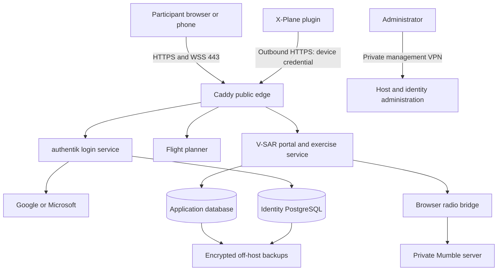

# V-SAR public hosting, identity, and participant invitation plan

Date: 2026-09-09. Status: proposed implementation plan; no deployment or identity changes made.

**Current hosting decision:** stage the public pilot in the existing lab behind OpenWrt. The [lab-hosted deployment plan](LAB_HOSTED_DEPLOYMENT_PLAN.md) is authoritative for the initial topology, sequence and cost. Cloud sections below are retained as future migration options; the identity, invitation and authorization requirements remain applicable.

## 1. Recommended outcome

Deploy an invitation-only V-SAR training service on isolated lab infrastructure initially. Participants use a trusted HTTPS site to accept an invitation, sign in with Google, Microsoft, or a local username/password, complete the required second step, and enter their assigned exercise station. Instructors manage exercises and invitations without distributing shared passwords or VPN profiles to ordinary browser participants.

Keep X-Plane, XPPython3, Air Manager, and PilotEdge on the participant workstation. This is a hosted coordination/radio/training platform, not a browser port or cloud-streamed version of X-Plane. The desktop plugin initiates outbound HTTPS connections to the hosted API.

Future cloud option: Google Cloud Run for stateless web services, Cloud SQL PostgreSQL for persistent application data, Cloud Storage for artifacts, and Compute Engine for identity/radio. Section 3a describes this deferred option; the linked lab plan governs the current pilot. No cloud purchase or deployment is part of the initial stage.

Initial scope: one organization and one active exercise at a time, with multiple aircraft and participant roles. Preserve past exercises with explicit access rules. Design exercise IDs into memberships now; simultaneous independently isolated exercises are a later gate, not an existing capability.

## 2. Current public-hosting blockers

Reviewed the local working tree on 2026-09-09. Other work is in progress; findings describe inspected code, not a verified deployed configuration. Recheck before implementation.

| Evidence | Problem | Required change before public access |
|---|---|---|
| `services/exercise/app/access.py`, `authenticate_code()` | `ADMIN` or `INSTRUCTOR` creates an instructor session whenever an instructor environment token exists, without supplying that token. | Remove this shortcut; add regression tests. |
| Same file, roster seeding and login | Predictable codes such as `INSTR-1` directly grant roles. The roster token is not required by code login. | Replace code authentication with verified identity and invitation acceptance. QR codes identify an invitation or station; they do not grant a privileged session. |
| Same file, `enforce()` | Missing configured tokens can allow a request. | Deny by default; fail startup in production when required identity configuration is missing. |
| `main.py`, login and `/join/{code}` | Login cookies lack `Secure`; login returns the session ID to JavaScript; join GET creates a session. | Server-side OIDC flow, secure host-only cookies, no browser-visible bearer session secret, explicit POST acceptance. |
| `access.py`, `presented()` and session resolution | Role/session secrets accepted in URL query parameters. | Remove for hosted deployment; scrub old links and invalidate legacy sessions. |
| `main.py`, `/ws`; `radio.py`, radio handshake | Origin checks do not establish identity. State streaming has no membership check, and radio can fall back to access-code/client-provided identity. | Authenticate and authorize state feeds and voice connections, with revocation during an open socket. |
| `radio.py`, ICS and channel state | Shared process state and control endpoints need aircraft/exercise ownership checks. | Scope radio nets, ICS, callsigns, and control actions to server-assigned stations. |
| `services/flightplanner/app.py`, `/api/sar/export-vsar` | Public-style planner requests can cause writes using server-held console credentials. | Authenticate the caller and authorize the target exercise and operation before any downstream write; remove global instructor credentials from ordinary planner requests. |
| Compose and Caddy configuration | LAN ports 8700/8090/8743 and internal CA TLS are the current deployment model. | Dedicated production configuration, public certificates, and no directly exposed backend/database ports. |

Do not expose the current stack by adding a router forward. Leave existing lab/router/WireGuard services intact. Replace identities and rotate credentials as part of a controlled cutover, not by deleting the current deployment.

## 3. Earlier VM hosting baseline (superseded by Section 3a)

Illustrative names below use a domain the owner will select; they are not existing DNS records.

- `vsar.<domain>`: participant portal, console, debrief, and radio; serve same-origin API and WSS routes.
- `auth.<domain>`: authentik public authentication endpoints. Restrict administrative access using validated reverse-proxy/identity policies and a private management path; do not inadvertently block login endpoints.
- Planner: preferably mounted behind a tested portal path; use a separate subdomain and separate OIDC client if its existing URL construction makes path mounting brittle. Do not share domain-wide session cookies.
- Separate production and staging hostnames, databases, keys, OAuth clients, mail configuration, and backup prefixes. Avoid importing real participant data into staging.
- Public ingress: TCP 443; TCP 80 only for certificate validation/HTTPS redirects if the chosen certificate method requires it. SSH and identity/database administration use private management access. No internet-facing PostgreSQL, Docker socket, Gitea, ragd, or lab management interfaces.
- Public stack has no broad route into the home/lab network. Pull reviewed release artifacts through a controlled deployment path. If Gitea access requires a tunnel, restrict it to the deployment identity, destination, and port rather than attaching the application network to the LAN.
- Browser voice reaches private Mumble through the bridge. Direct native Mumble clients initially use private access. If public native Mumble is required, separately design registered-client identities and per-exercise ACLs: web Google/Microsoft login does not automatically authenticate a native Mumble client. Do not rely on a shared server password as individual authorization.

Start with one dedicated VM and Compose for a small pilot; choose an initial engineering target of 4 vCPU/8 GiB RAM and measure, not a capacity promise. A single VM is a single point of failure. Keep an exercised rebuild procedure before claiming availability. Authentik documents Compose for small production installations, with a 2-core/2-GB minimum for its own host; that minimum is not sizing for the whole V-SAR stack. [Installation guidance](https://docs.goauthentik.io/install-config/install/docker-compose/)

Keep application SQLite for an initial single-process validation if it reduces migration risk. Back it up using SQLite's backup API, not a live file copy. Migrate application persistence to PostgreSQL with versioned migrations before independent concurrent exercises or multiple application replicas. PostgreSQL alone will not fix the current in-memory hub/radio state: add exercise-scoped state ownership and shared event distribution before scaling workers. Identity uses its own database/user from the start.

## 3a. Deferred Google Cloud Run migration option

Cloud Run is a good fit for the portal, invitation workflow, flight-planning HTTP service, exercise APIs, and debrief pages after state is externalized. It does not make the current stateful Compose stack a drop-in serverless application. Keep all services in a dedicated Google Cloud project and nearby region, with no broad lab-network access.

| Component | Proposed Google Cloud placement | Required adaptation |
|---|---|---|
| Portal, exercise API and debrief | Cloud Run service | OIDC/membership authorization; PostgreSQL persistence; remove authoritative process-local exercise state. |
| Flight planner | Separate Cloud Run service | Its Dockerfile already uses `$PORT` and Gunicorn. Move mutable aviation data/chart updates outside the container and authorize console exports. |
| Invitations and user memberships | Exercise service + Cloud SQL | Transactions, durable sessions, expiring invitations, revocation and per-exercise authorization. |
| Tracks and other application records | Cloud SQL PostgreSQL | Migrate from SQLite before public Cloud Run cutover; bound connection pools against maximum instances and database capacity. |
| Charts, exports and backup artifacts | Private Cloud Storage buckets | Authorized downloads or short-lived signed URLs; no participant-readable public bucket. Immutable reference data may be packaged in images. |
| Login, passwords and MFA | authentik server/worker on an isolated Compute Engine VM initially | Preserve the Open Source proof and MFA gates; separate identity database/user. This is an operational recommendation, not a claim that hosting authentik elsewhere is impossible. |
| Mumble and browser radio bridge | Compute Engine initially | Extract radio from FastAPI's web process; authorize participants through scoped radio tickets or shared session validation. Keep native Mumble private unless explicitly required. |
| Secrets and images | Secret Manager + Artifact Registry | Separate least-privilege runtime/deployment identities, no long-lived service-account keys baked into images. |
| Scheduled imports and maintenance | Cloud Run Jobs / Scheduler | Idempotent work, explicit service authentication, locks where needed, no request-triggered uncontrolled database updates. |

Use an external HTTPS Application Load Balancer for `vsar.<domain>` routing: web/API traffic to Cloud Run, `/api/radio/*` to the radio VM backend, and `auth.<domain>` to identity. Validate selected load-balancer backend and WebSocket timeout behavior in staging. Caddy may remain a VM-local proxy, but is no longer the mandatory public edge for Cloud Run. A pilot can consolidate identity and radio on one VM with separate users/networks; separate VMs reduce their shared failure/security boundary as usage grows.

Restrict Cloud Run ingress to internal-and-cloud-load-balancing so direct internet requests to `run.app` cannot bypass the edge. Consider disabling the default URL only after checking Scheduler/service dependencies. Participant-facing routes use application OIDC authorization; do not accidentally require participants to have Google Cloud IAM accounts, which would break Microsoft/local-account access. Private service endpoints separately use service-to-service authentication. [Cloud Run ingress controls](https://docs.cloud.google.com/run/docs/securing/ingress)

Use private VPC connectivity from Cloud Run to Cloud SQL and internal services; allow only required destinations/ports. VM management stays private, with no public SSH or database port. Provision a tested outbound path for identity providers, SMTP and external chart/weather sources when using private-only hosts. Cloud SQL connectivity has a documented Cloud Run integration. [PostgreSQL connection guidance](https://docs.cloud.google.com/sql/docs/postgres/connect-instance-cloud-run)

### Cloud Run constraints that change implementation

1. **Persistent storage:** the writable container filesystem is in-memory and non-durable. Do not put production SQLite databases, session state, uploaded files, or downloaded charts there. Use SQL/object storage as above; do not solve database persistence by putting a live SQLite file on a bucket mount. Configure the exercise container's ingress port explicitly or adapt it to `$PORT`. [Runtime contract](https://docs.cloud.google.com/run/docs/container-contract)
2. **Live connections:** Cloud Run supports WebSockets, but connections have request timeouts, with a maximum of 60 minutes. Implement reconnect with jitter, reauthentication, sequence-based catch-up or fresh snapshots, and safe station restoration. No reconnect may automatically resume PTT. An open WebSocket keeps its instance active and billable. [WebSocket guidance](https://docs.cloud.google.com/run/docs/triggering/websockets)
3. **Shared exercise state:** session affinity is best-effort. Different participants, reconnects, revisions and instances can reach different processes. Refactor the `hub`, membership/session caches and radio/ICS globals; persist authoritative state and use a shared event mechanism. Initially, database-backed incremental polling can avoid a Redis service for map/state updates; retain low-latency voice on the VM. If retaining push feeds across instances, use an explicitly designed shared broadcast layer. Max-instances=1 is not a correctness solution, including during restarts/deployments. [Multi-instance synchronization](https://docs.cloud.google.com/run/docs/tutorials/websockets?hl=en)
4. **Native voice:** ordinary Cloud Run services expose HTTP/gRPC ingress, not the native Mumble TCP/UDP listener. Keep Mumble on Compute Engine; preserve private access or separately configure narrowly exposed native voice ports. Browser WSS can run on Cloud Run, but the current bridge's connection state and timeout-sensitive voice experience make a VM the simpler first release. [Runtime contract](https://docs.cloud.google.com/run/docs/container-contract)
5. **Background work:** move unbounded background refresh loops into explicit jobs/workers or a deliberately provisioned always-on component. Request-driven scaling and container restarts cannot own the exercise clock. Persist timestamps/state and reconstruct on startup.

The revised release path is: fix security blockers; prove authentik flows; migrate application persistence and externalize state; deploy HTTP services to staging Cloud Run; extract/secure radio on the VM; then run interruption and external-participant tests. Test instance replacement, two instances at once, a rollout between revisions, database connection exhaustion, and sessions exceeding 60 minutes.

The earlier 15–25-day estimate was for the VM pilot. Allow an additional provisional 4–8 developer-days for PostgreSQL migration, Cloud Run state refactoring, routing, and radio separation: **19–33 days total**, subject to a migration spike. Database-backed polling is the initial recommendation; Redis/distributed push and Cloud SQL HA add cost and implementation choices rather than being assumed free.

Cloud Run's idle savings do not make this architecture free: Cloud SQL, the identity/radio VM, the load balancer, storage/backups, email and voice egress still cost money. Warm instances and live sockets also change the cost profile. Prepare a region-specific estimate with actual exercise hours and concurrency before provisioning. The account/invitation/MFA requirements in Sections 4–7 are unchanged.

## 4. Authentication and MFA

Use authentik as the credential authority. V-SAR stores an immutable user ID and memberships, not passwords or TOTP secrets. Its Open Source edition provides a free identity platform; operating the service still requires compute, backup, and maintenance. [Pricing](https://goauthentik.io/pricing/)

| Sign-in option | Proposed experience | Assurance policy |
|---|---|---|
| Google | Continue with Google, then return to the invitation/portal. | Do not assume every Google login proves MFA. Apply the V-SAR second-step policy unless an explicitly tested trusted assurance mapping satisfies it. |
| Microsoft | Continue with Microsoft; support personal Outlook/Hotmail and work/school accounts. | Same assurance rule; organization consent restrictions may need that organization's administrator. |
| Local account | Choose username/password, verify email, enroll an authenticator or email-code method. | TOTP recommended; email codes allowed for ordinary participant access under the lower-assurance policy below. |
| Instructor or platform administrator | Any supported primary login, then authenticator-app challenge. | Require TOTP initially; add passkeys later. Email-only challenges cannot grant privileged access. |

Configure ordinary Google and Entra OAuth sources. Avoid making the design depend on authentik's Enterprise-only Source stage; prove the complete enrollment and post-federation MFA flow using an unlicensed Open Source staging instance before committing. Google integration and Entra integration are documented separately. [Google](https://docs.goauthentik.io/users-sources/sources/social-logins/google/cloud/), [Microsoft](https://docs.goauthentik.io/users-sources/sources/social-logins/entra-id/oauth/)

For Microsoft app registration, select organizational and personal Microsoft account support rather than a single-tenant-only registration. Verify real personal and organizational accounts in staging, including missing email claims and administrator consent failures. [Microsoft account types](https://learn.microsoft.com/en-us/graph/auth-register-app-v2)

Use minimal identity scopes. Do not request mailbox, contacts, Drive, or organization group synchronization merely to log in. Configure exact HTTPS callback URLs and rotate client secrets. Key identities by issuer/subject, not mutable email or display name. Link a second provider only after proving control of the existing account; never automatically merge accounts solely because email strings match.

V-SAR uses OIDC authorization code flow with PKCE, state and nonce checks, and server-side token exchange. Validate signature, issuer, audience, lifetime, and intended client with a maintained library. Establish an opaque server-side application session. Cookies: Secure, HttpOnly, SameSite=Lax, host-only, rotated after authentication/privilege changes. Add CSRF protection to mutating cookie-authenticated requests. Use exact redirect allowlists and trusted-proxy configuration; ignore spoofed client identity headers.

### Free MFA choices and recovery

Authenticator apps generate TOTP codes locally; no SMS or per-message delivery charge is needed. Offer standard six-digit enrollment with a confirmation challenge, plus single-use recovery codes. Authentik provides both TOTP setup and email-code authenticators. [TOTP](https://docs.goauthentik.io/add-secure-apps/flows-stages/stages/authenticator_totp/), [Email codes](https://docs.goauthentik.io/add-secure-apps/flows-stages/stages/authenticator_email)

Email codes meet the requested convenient second-step option, but should be labeled lower assurance. NIST does not accept email for out-of-band authentication; this plan does not claim that email login meets NIST AAL2. Keep email for invitations, address verification, local password recovery, and the explicitly limited participant second step. [NIST guidance](https://pages.nist.gov/800-63-4/sp800-63b.html)

- Require TOTP for instructor/admin actions, including promotion into those roles. Enforce this at the API/session authorization layer, not just by hiding buttons.
- Configure second-factor enforcement after social sign-in as well as password sign-in; test enrollment cannot be skipped and missing authenticators do not silently bypass the challenge. [Authenticator validation](https://docs.goauthentik.io/add-secure-apps/flows-stages/stages/authenticator_validate/)
- Proposed email code lifetime: 5 minutes, one use, bounded attempts and resends; invalidate superseded challenges. Rate-limit by account and network without enabling trivial permanent account lockout.
- Use authentik's maintained password hashing and breached/common-password controls where supported; permit long passphrases and password managers. Do not build a password store in FastAPI.
- Password reset alone must not remove TOTP or bypass privileged MFA. Lost authenticators use recovery codes or audited administrator-assisted recovery; require stronger recovery for admins. Revoke old sessions when factors or credentials are reset.
- Keep two named platform administrators and secured recovery credentials. Alert on administrator MFA resets, factor removal, and privilege changes.
- Email delivery is not guaranteed free: use an existing suitable transactional SMTP relay if available; otherwise select a provider after checking quotas and pricing. Configure SPF, DKIM, DMARC, bounce handling, and delivery monitoring. Keep OTP codes, reset tokens, and invitation tokens out of logs.

## 5. Invitation and participant workflow

1. Instructor creates an exercise and roster assignments: base, pilot, observer, scanner, ground team, or evaluator. Platform administrator and exercise instructor are distinct privileges.
2. Instructor enters an email address and selects the exercise role, aircraft/team, and membership expiry. Ordinary instructors cannot invite platform administrators or grant privileges they lack.
3. Server creates a cryptographically random invitation, storing only its hash, recipient, exercise, proposed role, creator, expiry, and status. Suggested expiry: 72 hours; resend invalidates the old invitation.
4. Recipient opens the link or QR code and sees the exercise name and invitation status. GET does not consume the invitation, because email scanners may visit links automatically.
5. Recipient signs in or creates a local account and completes the required MFA enrollment/challenge.
6. Server verifies control of the invited email. A missing/untrusted provider email claim requires explicit email verification; mismatched addresses require a corrected invitation. Do not silently apply Gmail-style alias canonicalization to other providers.
7. A CSRF-protected acceptance POST atomically consumes the invitation and creates the membership. Reuse, concurrent double acceptance, revocation, and expiry are rejected.
8. Participant lands on their assigned station with callsign, briefing, audio/microphone check, connection status, and a Join exercise action. A returning member signs in directly and chooses an authorized exercise.
9. Instructor sees pending/accepted/expired/revoked invitations and active participants. Removing a membership immediately stops exercise access and voice/telemetry permissions, including existing sockets.

The app owns invitations and exercise memberships; the identity service owns authentication/enrollment. Disable uncontrolled self-registration. If an upstream login creates an identity without an invitation, it receives no project data or membership and cannot enter an exercise. Demonstrate this deny path explicitly.

Proposed application tables: `users`, `external_identities` (or stable broker subject mapping), `exercises`, `memberships`, `invitations`, `sessions`, `device_credentials`, `audit_events`. Memberships include user, exercise, role, station/aircraft/team, status and expiry; do not copy a role into a long-lived session and forget to revalidate it. Keep authority over memberships in one place.

## 6. Authorization, simulator devices, and voice

| Principal | Allowed scope |
|---|---|
| Platform administrator | Deployment/account administration; exercise content access requires an explicit policy, not an accidental global instructor role. |
| Instructor/evaluator | Assigned exercise configuration, invitations within delegation limits, start/stop, effects, truth reveal and debrief. Separate read-only evaluation if needed. |
| Base staff | Assigned exercise map, bearings, messages, authorized net operations. No hidden beacon truth or administrator setup. |
| Aircrew | Assigned aircraft/station, permitted planning and radio, exercise briefing and released debrief. |
| Ground team | Assigned team/station and permitted radio/reporting. No other exercise data. |
| Simulator device | Assigned aircraft telemetry and required simulator truth endpoint for one exercise. No human administration or general roster access. |

Apply these rules on all reads, writes, downloads, historic tracks, WebSocket subscriptions, channel changes, and ICS commands. Filter broadcasts before transmission; never send beacon truth to participant browsers and merely hide it in JavaScript. Callsigns and aircraft identities come from membership/device assignments, not client claims. Required simulator truth remains accessible to an authorized workstation operator; acknowledge this training trust boundary rather than claiming it can be hidden from the machine computing propagation.

Pair a simulator while the instructor/aircrew member is authenticated, using an expiring one-time device approval. Issue a unique revocable device credential bound to aircraft/exercise, with short-lived access tokens or a strictly expiring scoped pilot credential for the first release. Store secrets outside the repository with OS file permissions. Never put a human instructor token in a participant plugin or Air Manager package. Rotate/revoke on reassignment or exercise closure.

Authenticate browser radio before allocating a Mumble connection; validate exact allowed origins and reject anonymous browser handshakes. Bound connection counts, messages, frame sizes, receive queues, and PTT leases. Recheck membership on channel changes and periodically during sessions; target revocation propagation within 30 seconds. Disconnect and release PTT on logout, expiry, device loss, or membership removal. Preserve existing transmit watchdog behavior.

Current radio sends 48 kHz mono 16-bit PCM: 768 kbit/s per continuously carried audio stream before framing/TLS overhead. Sixteen simultaneous listener streams are about 12.3 Mbit/s, or 11 GB over two hours if continuous. Measure actual activity and fan-out before sizing egress. Initial validation can retain the current WSS bridge; an Opus/WebRTC redesign is a separate optimization with its own STUN/TURN, browser, and relay-cost testing. Do not assume an HTTP proxy also carries native Mumble UDP or that WebRTC is already implemented.

## 7. Infrastructure controls and operations

- Build tagged immutable images from reviewed Gitea commits. Run CI checks and dependency/image scanning; maintain a patch owner and a scheduled update/rollback process. Do not auto-deploy unrelated local edits.
- Dedicated runtime users, non-root containers where supported, dropped capabilities, resource limits, and read-only filesystems except explicit writable volumes. No privileged containers or Docker socket mounts in web/identity workloads.
- Separate backend/identity/database networks and database credentials. Restrict outbound access to needed identity, mail, map/weather/chart, and update sources after inventorying actual dependencies. Prevent arbitrary URL fetching and cloud metadata access.
- Store secrets in the cloud secret service or narrowly readable injected files, not images/Git/browser JavaScript. Use separate credentials per environment and service. Test that debug/errors and generated participant kits disclose none.
- Caddy with public TLS renewal; HTTPS redirects, HSTS after hostname validation, security headers and a tested CSP. Allow microphone access only where needed. Disable caching for authenticated API/identity responses; cache only appropriate static resources.
- Enforce rate/size limits at edge and application layers, including expensive planner downloads/updates and login/invitation/OTP endpoints. Configure trusted forwarding correctly so attackers cannot choose the rate-limit identity. WAF/CDN is optional and does not replace application authorization or volumetric protection from the host provider.
- Separate liveness/readiness from public detail: public health reports minimal status; metrics and detailed health remain private. Alert on login failures, unusual invitations, permission changes, voice saturation, database errors, disk capacity, failed backups and certificate expiry.
- Encrypted daily off-host backups of application and identity databases, required keys/configuration, and exercise artifacts. Use separate backup credentials and retention protections. Proposed pilot objectives: RPO 24 hours, RTO 4 hours; test an isolated restore before launch and quarterly. Back up before migrations and after significant exercise sessions.
- Preserve tracks, assignments and events needed for debrief; voice remains unrecorded by default. Proposed retention: 90 days for exercise records and audit logs pending owner review. Exports/deletion require authorized roles; avoid unnecessary birth dates or identity-provider profile data.
- Document logout/revocation, compromised-account response, mail outage, identity outage, database restore, and rebuilding a host. Identity outage must not enable anonymous access; existing bounded sessions may continue only while local authorization/revocation checks remain available.
- Maintain a protected deployment checklist and named primary/backup operators. Test remotely from cellular and a separate residential connection, not just from inside the lab.

## 8. Phases and exit gates

Estimates below are engineering planning estimates for one developer familiar with the code; they are not vendor quotes and exclude delays obtaining domain/identity/SMTP access.

| Phase | Work | Exit gate | Estimate |
|---|---|---|---|
| 0: baseline and containment | Snapshot current release; endpoint/permission inventory; remove instructor shortcut, predictable role logins and fail-open production behavior; protect planner/state/radio paths. | Regression tests prove anonymous and wrong-role requests fail, including missing configuration. | 2–3 days |
| 1: isolated staging | VM/network, production Compose/Caddy, DNS/TLS, secret injection, authentik/database, SMTP, backup/restore. | Only intended ingress exposed; valid TLS; successful isolated restore; no lab network dependency for participants. | 2–3 days |
| 2: identity and MFA | OIDC integration, Google/Microsoft/local flows, recovery and assurance enforcement. | All sign-in methods tested in Open Source edition; no MFA/account-linking bypass; personal and organization Microsoft accounts tested. | 3–5 days |
| 3: invitation and roles | Membership schema/migrations, invitation UI/email, atomic acceptance, station assignments, historic-data authorization and session revocation. | Two exercises' memberships cannot access each other's records; forwarding/replaying an invite cannot steal a role. Only one exercise needs to run live. | 3–5 days |
| 4: simulator and radio | Device pairing/scopes, radio channel authorization, reconnect/expiry behavior, rate/resource limits, planner caller authorization. | Revoking a participant/device stops its live access within 30 seconds; target-sized voice rehearsal passes. | 3–5 days |
| 5: pilot and release | External participant rehearsal, load/recovery tests, help/runbooks, staged data migration, credential rotation and cutover. | Complete invited exercise and authorized debrief; restart/recovery drill; launch acceptance signed off. | 2–4 days |

Initial pilot estimate: 15–25 developer-days. Independent concurrent exercises, distributed radio state, multi-replica availability, WebRTC/Opus migration and a browser-hosted flight simulator are excluded from that estimate.

Pilot test target: 20 signed-in participants, 3 aircraft, up to 16 browser radio sessions with the current configured cap. Verify actual CPU, memory, latency, egress, mobile microphone behavior, tab/background suspension and reconnects. Adjust limits from evidence before extending invitations.

Required negative tests include: known starter/admin strings rejected; expired/revoked/reused invitations; wrong email; social account linking collisions; password reset cannot bypass MFA; invalid OIDC state/nonce/audience/issuer; CSRF and forged forwarding headers; cross-exercise IDs and hidden truth; unauthenticated WebSockets; revoked roles on existing sockets; callsign/channel spoofing; device credentials used on instructor routes; planner acting as a privileged deputy; missing secrets; and restore with identity/app IDs intact.

Cutover: back up and freeze mutations briefly, migrate approved records, deploy a pinned release, rotate old shared tokens, invalidate old sessions/QR links, issue individual invitations, test externally, and reopen exercises. Rollback restores a tested application/database pair and returns the service to private access if authentication cannot be preserved. Never roll back to public fail-open behavior.

## 9. Cost and decisions before provisioning

The Cloud Run proposal now has a [five-day, 25-participant cost estimate](CLOUD_RUN_COST_ESTIMATE.md): approximately $140–$170/month standing cost, plus $25–$55/event for five 8-hour days, under its stated region, traffic and availability assumptions.

No per-login charge is required for TOTP and the proposed identity software is free. Domain registration, VM/disk, voice egress, off-host backups, transactional email above any existing allowance, and operator time remain real costs. Price the chosen cloud region and measured radio traffic before selecting a plan; do not budget a free tier as a permanent production guarantee. Set budget alerts and quotas before the public pilot.

Owner choices needed before deployment, not to complete this plan:

1. Domain/subdomains and cloud account/region; proposed default is isolated cloud hosting near the initial participant group.
2. Expected peak attendance and whether public native Mumble access is needed in addition to browser radio.
3. SMTP sender/relay and who controls Google/Microsoft app registrations.
4. Confirm email-code access for ordinary participants and mandatory authenticator apps for privileged roles.
5. Backup/retention targets and named primary/backup administrators.

Implementation should start with Phase 0 and a staging identity proof. Infrastructure provisioning, paid services, public DNS/cutover, and sending actual invitations are separate execution steps; none were performed while writing this plan.
