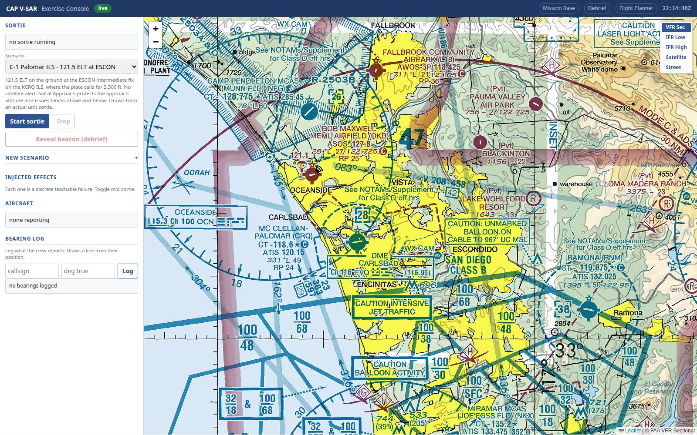
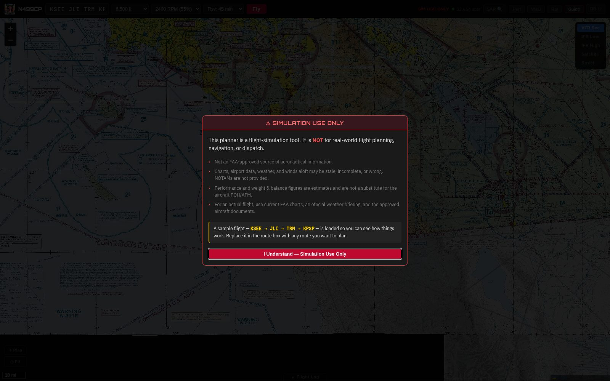
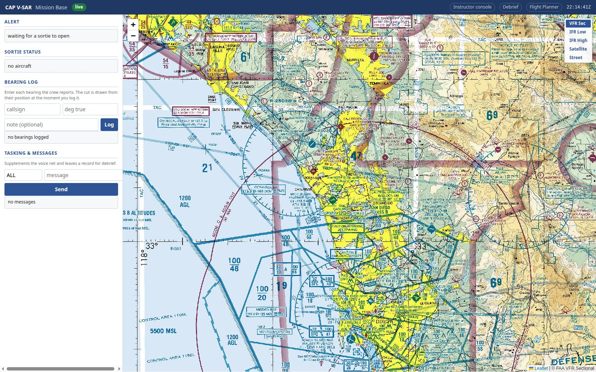

# Fly It Twice Before You Fly It: Rehearsing a SAREX on the Simulator

**Date:** 2026-09-08
**Project:** CAP V-SAR
**Category:** Aviation / Build Log
**Skills Demonstrated:** Training program design, exercise planning, search-pattern execution, mission-base coordination

## The Problem

A Civil Air Patrol Search and Rescue Exercise (SAREX) is expensive in the ways that matter: aircraft hours, fuel, a Saturday of a few dozen volunteers' time, and a practice beacon somebody has to drive up a hill and switch on. And for a lot of the people in it, it's also the *first* time they've done the thing they're there to practise. A new Mission Observer's first look at a cone of confusion — the bearing swinging wildly as the aircraft passes over the beacon — happens at 1,000 feet over real terrain, with a real pilot waiting for a heading call.

That's backwards. The exercise should be where a skill gets reinforced, not where it gets introduced.

## The Approach

CAP V-SAR was built so that the missions in a SAREX can be flown before the SAREX, by the same crews, in the same seats, against the same incident. The exercise director writes the scenario once. The wing runs it three times on the simulator — two weeks out, one week out, two days out — and then flies it for real.

The scripted incident for the October exercise is an overdue rental Cessna on a VFR flight from Carlsbad to Thermal, with a registered 406 MHz ELT producing a satellite composite position in the mountains east of Julian. Three air tasks fall out of that, exactly the way a real Incident Commander would build them: a creeping-line route search along the intended track, an ELT search that homes on the beacon and refines its position with an expanding square, and a parallel-track grid search of the neighbouring quadrant in case the satellite position is wrong.

*The instructor console: the beacon goes on a ridge, the effect set starts small, and the true position is withheld from every other view until debrief.*

## Session One: The Base Stands Up

Nobody flies in the first session. The Air Operations Branch Director builds the three search patterns in the flight planner from the assignment sheets — track spacing, initial heading, turn direction — and exports each one as an X-Plane flight plan for the crews to load into the G1000. The terrain profile on the route search flags a leg with poor clearance, and it gets re-drawn 500 feet higher. That's a correction a real briefing would have to make; it just got made on a Tuesday night instead.

*Patterns are built from the same assignment sheets the live exercise will use, and pushed to the mission base map.*

The Mission Radio Operator joins the mission net from a tablet and works the channel plan. The three Mission Observers sit at their stations — G1000 MFD, audio panel, direction finder, mission radio — and drill the parts that bite people on the real day: the audio panel's COM3 MIC selection, channel entry on the mission radio, DF head power-up, and tuning 406.025 rather than 406.037. Radio checks, and the first 30-minute ops-normal cycle, before anyone leaves the ramp.

## Session Two: The Full Mission

Same people, same seats. The IC briefs on the voice net. Sortie A flies its creeping line and calls each leg; the base learns to keep three aircraft's ops-normal clocks straight. Sortie C flies its grid, and when the aircraft banks toward the beacon in a turn the director injects *wing blanking* — the signal drops out on one wing, and the crew learns that a null in a turn is not a lost signal.

Sortie B is where the training lands. On the DF head the 406 burst shows as a bearing that appears every 50 seconds and holds between bursts. Twenty minutes in, the director injects *cone of confusion*. The observer reports the swinging bearing as real, then recognises the symptom, calls "passing overhead", and starts an expanding square from that point. Then *multipath*: a false reciprocal bouncing off a ridge. The observer takes one bad bearing — and it's the mission base, not the cockpit, that catches it, because the plotted cut disagrees with the three before it. The base asks the crew to re-fly the leg.

*The base plots what the cockpit reports. When one cut disagrees with the others, base staff — not the crew — are the ones who should notice.*

That exchange is what a SAREX exists to practise. It has now happened once before the live day.

At debrief the director reveals the beacon. The replay shows every reported bearing against truth: the multipath bearing is 140 degrees off; the two good ones are within 8. The Skills Evaluation Trainer sits in and notes which tasks were demonstrated and which need another look.

## Session Three: Dress Rehearsal

Nothing about the incident changes except that everything is now exactly as it will be on Saturday: real callsigns, the frequencies from the real communications plan, the real grid numbers, the same timing, and the composite position moved to where the practice beacon will actually be. Crews fly it cold, with the director injecting the effects that caused trouble the week before. Sortie B finds the beacon on the first expanding square. The bearing plot has no rejected cuts.

## The Result

On Saturday the crews brief, launch, and fly the same three assignments against a real practice beacon, with real terrain, real weather, real radios and a ground team. Every procedure — panel setup, leg calls, bearing reports, recognising a cone of confusion, retasking, the ops-normal cadence, the comms log — has been performed at least twice. What the live day adds is the airplane, the weather, and the pressure. The debrief compares the live bearing plot against the rehearsal numbers, and the evaluator signs off tasks that were demonstrated on both.

The skill was learned at home over three evenings. The SAREX reinforced it.

## What I Learned

Two things. First, the instructor's ability to inject a specific failure mode at a specific moment — a cone of confusion right when the crew has stabilised on a bearing — is worth more than any amount of propagation fidelity. Real ELT searches don't reliably hand a new observer the hard case; the simulator can. Second, the most valuable thing the debrief measures isn't the cockpit at all: it's whether the base cross-checked the cockpit. That number only exists because base staff were in the loop with real tools, not listening in.

## Try It Yourself

The pattern doesn't need this particular system. Write the exercise's incident and assignments first; rehearse the base with nothing flying; rehearse the whole mission with the hard cases injected on purpose; then run a dress rehearsal that matches the live day exactly. Measure the same things each time. The live exercise becomes the fourth repetition, which is what it should have been all along.

---
*Built with Claude Code, Gemini, and Codex working the same codebase. Lab documented at rpc-cyberflight.com.*
