# CAP V-SAR Simulator Exercise Guide
## Conducting an Emergency Locator Transmitter (ELT) Search Exercise in the ESCON Corridor

**Publication Type:** Civil Air Patrol Virtual Search and Rescue (CAP V-SAR) Training & Procedures Guide  
**Scenario Reference:** Scenario C-1 — McClellan-Palomar (KCRQ) ILS 121.5 MHz ELT Search at the ESCON Fix (`CAWG Pauma Valley Mountain SAREX`)  
**Doctrinal References:** CAPR 100-1 (*Radio Communications Policy*), CAPR 100-3 (*Radiotelephone Procedures*), CAPP 100-3 (*Standard Radio Communications Guide*), CAPF 110 (*Communications Log*), ICS 204 (*Assignment List*), ICUT (*Introductory Communications User Training*), and MART Vol. II (*Mission Aircrew Reference Text, Volume II*)

---

> **EXERCISE TRAFFIC — NOT A REAL DISTRESS**
>
> Everything described in this guide takes place inside a desktop search-and-rescue simulator. All radio calls made during an exercise must begin with the words **"EXERCISE TRAFFIC"** when required by your communications plan, and every screen displays the banner **EXERCISE TRAFFIC · NOT A REAL DISTRESS**.
>
> **Training Disclaimer:** CAP V-SAR is a supplemental rehearsal and practice tool. It is not an approved Civil Air Patrol national program, and it does not replace official Civil Air Patrol training, approved flight or ground procedures, specialty qualification sign-offs, or real-world operational authority. Always follow your wing's current procedures and official CAP publications.

---

## Table of Contents

1. [Purpose and Overview of the Simulator](#1-purpose-and-overview-of-the-simulator)
2. [The Running Scenario: 121.5 MHz ELT Search in the ESCON Area](#2-the-running-scenario-1215-mhz-elt-search-in-the-escon-area)
3. [Positions, Roles, and Who Does What](#3-positions-roles-and-who-does-what)
4. [Phase 1: Exercise Director Setup, Seat Emails, and Invitations (`/setup`)](#4-phase-1-exercise-director-setup-seat-emails-and-invitations-setup)
5. [Phase 2: Participant Sign-In (Google & Offline Badge), Boarding Pass, and Ready Room (`/login`, `/join`, `/ready`)](#5-phase-2-participant-sign-in-google-offline-badge-boarding-pass-and-ready-room-login-join-ready)
6. [Phase 3: Pre-Flight Mission Planning and Search Patterns (`/planner/`)](#6-phase-3-pre-flight-mission-planning-and-search-patterns-planner)
7. [Phase 4: Mission Base Operations and Radio Procedure (`/base`, `/radio`)](#7-phase-4-mission-base-operations-and-radio-procedure-base-radio)
8. [Phase 5: Airborne Search, Direction Finding, and the AI Mission Pilot](#8-phase-5-airborne-search-direction-finding-and-the-ai-mission-pilot)
9. [Phase 6: Exercise Direction and Signal Conditions (`/instructor`)](#9-phase-6-exercise-direction-and-signal-conditions-instructor)
10. [Phase 7: Ground Team Verification and After-Action Debrief (`/debrief`)](#10-phase-7-ground-team-verification-and-after-action-debrief-debrief)
11. [Capabilities Currently Under Development](#11-capabilities-currently-under-development)
12. [Appendix A: Technical Staff Setup and System Administration](#12-appendix-a-technical-staff-setup-and-system-administration)

---

## 1. Purpose and Overview of the Simulator

A Search and Rescue Exercise (SAREX) is Civil Air Patrol's structured training event in which an Incident Commander (IC) and Mission Base staff task aircrews and ground teams to locate a simulated distress beacon or missing aircraft. In live flying, time on station is limited by fuel, weather, airspace congestion, and aircraft availability.

The CAP V-SAR simulator allows a squadron or wing to rehearse the complete mission chain from home or from a squadron training room before flying the live SAREX:

1. **Mission Base and Command Stations** run in a standard web browser on laptops or tablets. Staff see live aircraft tracks on aeronautical charts, operate the mission radio console, maintain the **CAP Form 110** (*Communications Log*), plot direction-finding (DF) bearings, and issue tasking assignments.
2. **Aircrew Stations** run the flight simulator (**X-Plane 12**) paired with dedicated **Mission Observer (MO)** instrument panels (**Air Manager**). Crews fly either the **Cessna 182T NAV III (Garmin G1000)** or the **Cessna 172SP**, operate the **Garmin GMA 1347** audio panel and **Technisonic TDFM-136B** tactical FM radio, and track distress beacons using the **Becker SAR-DF 517** or **RHOTHETA RT-600** direction finder.
3. **The AI Mission Pilot and Autopilot** can fly the aircraft through assigned search patterns or hand flight control back and forth with the cockpit **Garmin GFC 700** autopilot, allowing a Mission Observer trainee to practice electronic search even when a human Mission Pilot is not available.
4. **After-Action Debriefing** replays every aircraft's flight path against the hidden beacon location once the Exercise Director reveals it, scoring closest point of approach (CPA), track discipline, and bearing accuracy in degrees.

---

## 2. The Running Scenario: 121.5 MHz ELT Search in the ESCON Area

Throughout this guide, every procedure and screen is illustrated using a single realistic mission: **Scenario C-1 (`C-1  Palomar ILS - 121.5 ELT at ESCON`)**, conducted under the exercise designation **`CAWG Pauma Valley Mountain SAREX`**.

### 2.1 What "ESCON" Means in This Exercise

**ESCON** (`33.1700° N, 117.0792° W` / `33° 10.20' N, 117° 04.75' W`, ground elevation approximately `700 ft MSL`) is the charted **intermediate approach fix on the Instrument Landing System (ILS) Runway 24 approach to McClellan-Palomar Airport (KCRQ)** in northern San Diego County, California:

* **Charted Fix Geometry:** ESCON lies on the `065°` magnetic radial (`076.01°` true bearing) at **10.40 nautical miles (NM) DME** east-northeast of McClellan-Palomar Airport (`KCRQ`), situated in the inland valley corridor between Carlsbad, Escondido, Valley Center, Pauma Valley, and Ramona Airport (`KRNM`).
* **Airspace and Traffic Challenge:** The published FAA approach procedure for KCRQ ILS Runway 24 requires arriving instrument traffic to cross the ESCON fix at **3,300 ft MSL**. Because arriving aircraft occupy 3,300 ft MSL along the final approach course, Southern California Approach (**SoCal Approach**) protects that altitude and clears CAP search aircraft into **altitude blocks above and below the approach path** (for example, `4,000–5,000 ft MSL` or `5,500 ft MSL`).
* **Terrain Challenge:** Immediately east of the ESCON corridor, terrain rises steeply toward the **Ramona ridge and Pauma Valley mountains** (`3,977 ft` to `4,526 ft MSL`), causing terrain masking of low-altitude VHF signals and requiring strict minimum safe altitude awareness (`6,000 ft MSL` terrain clearance floor over the ridge).
* **Nature of the Alert:** A **121.5 MHz Emergency Locator Transmitter (ELT)** is transmitting from the ground near ESCON. Because 121.5 MHz analog beacons have not been monitored by COSPAS-SARSAT satellites since 2009, **there is no satellite position fix**. Mission Base receives only pilot reports of an audible 121.5 MHz warble within a **12 NM radius** of the McClellan-Palomar approach corridor.

### 2.2 Exercise Force Package and Fictional Sample Data

All screenshots and examples in this guide use the following fictional exercise roster. Each seat can be assigned a volunteer's Google email address in `/setup` Step 2 so they sign in with Google at `/login`, while every seat also receives a badge code (`INSTR-1-…`, `MRO-1-…`, `OBS-423-…`, `UDF-3-…`) as an offline or field fallback:

| Callsign / Station | Tail / ID | Aircraft / Station Type | Assigned Equipment | Crew / Staff Positions & Sample Emails | Mission Assignment (ICS 204) |
| :--- | :--- | :--- | :--- | :--- | :--- |
| **Incident Command (`IC`)** | `INSTR-1` | Exercise Console (`/instructor`) | Scenario & Fault Controls | Exercise Director / IC / SET (`director.ic@example.org`) | Overall command, safety, weather/signal faults, debrief reveal |
| **Mission Base (`MRO 1`)** | `MRO-1` | Mission Base (`/base`, `/radio`) | Motorola APX 4500 / Form 110 | Mission Radio Operator 1 (`mro1@example.org`), AOBD, MSA | Primary VHF-FM net control, 30-min Ops Normal log, LOP plotting |
| **Mission Base (`MRO 2`)** | `MRO-2` | Base Radio (`/radio`) | Icom IC-A120 Airband | Mission Radio Operator 2 (optional email or badge-only) | Secondary VHF-AM airband watch (`123.100 MHz` SAR & guard) |
| **`CAP 423`** | `CAP 487` / `N423CP` | Cessna 182T NAV III (G1000) | **Becker SAR-DF 517**, TDFM-136B, GMA 1347 | Mission Pilot (`PLT-423`, `pilot.423+sar@example.org`), Mission Observer (`OBS-423`, `observer.423@example.org`), Mission Scanner (`SCN-423`, badge-only) | Primary low-block search (`4,500 ft MSL`); 9-waypoint, 1.0 NM right-hand expanding square centered on ESCON |
| **`CAP 415` / `CAP 419`** | `N415CP` / `N984CP` | Cessna 182T / 172SP | **RHOTHETA RT-600**, TDFM-136B, GMA 1347 | Mission Pilot (`PLT-415` / `pilot.419@example.org`), Mission Observer (`OBS-415`, badge-only) | High-cover cross-bearing sortie (`5,500 ft MSL`) & airborne radio relay |
| **`UDF 1`** | `UDF-3` | Mobile Ground Team (`/radio`) | Portable VHF-FM & Handheld DF | UDF Team 1 Leader & Technicians (`udf1@example.org`) | Ground homing along Highway 76 / Valley Center Rd to locate ELT (`EX-ESCON-1215` found at `1842Z`) |
| **`UDF 2`** | `UDF-4` | Mobile Ground Team (`/radio`) | Portable VHF-FM & Handheld DF | UDF Team 2 Leader (badge-only) | Secondary ground cross-bearing standby at Ramona (`KRNM`) |

*All names, callsigns, and email addresses above are fictional (`example.org` is a reserved example domain). The screenshots were captured with sample `@cap.gov` placeholder addresses for the same seats; they are not real accounts. A badge code is the seat prefix followed by a long random string (for example `OBS-423-7494B34C…`); the ground teams' prefixes count their position in the staff list (`UDF-3-…` for `UDF 1`, `UDF-4-…` for `UDF 2` in this roster), so always read the full code from the printed card rather than guessing it.*

---

## 3. Positions, Roles, and Who Does What

Every volunteer signs in with Google at `/login` using the email address assigned to their seat—or uses their role-specific badge code as an offline/field fallback—which opens that member's assigned station automatically.

### 3.1 Command and Mission Base Staff

1. **Incident Commander (IC) / Exercise Director:**
   * Establishes the exercise name, aircraft fleet, staff roster, and per-seat Google email addresses on the **Exercise & Fleet Setup** screen (`/setup`).
   * Sends sign-in links or pre-filled invitation emails in `/setup` Step 4 (and prints backup badge cards for offline field use), then tracks who has joined via Google or badge code in Step 5 and the **Ready Room** (`/ready`).
   * Selects and starts the sortie on the **Exercise Console** (`/instructor`), manages signal propagation conditions (terrain masking, multipath, cone of confusion, wing blanking), and reveals the true ELT position during the debrief.
2. **Air Operations Branch Director (AOBD):**
   * Uses the **Flight Planner** (`/planner/`) before launch to generate geodetic search patterns (**Expanding Square `SS`**, **Parallel Track `PS`**, or **Creeping Line `CS`**) from the **ICS 204** (*Assignment List*) and exports `.fms` flight plans for the G1000 cockpit.
   * Monitors aircraft progress and plotted DF lines of position on the **Mission Base** map (`/base`), cross-checking reported bearings for multipath reflections or cone-of-confusion swing.
3. **Mission Safety Officer:**
   * Reviews terrain elevations along the assigned search area (specifically the `3,977–4,526 ft MSL` Ramona ridge east of ESCON), verifies minimum safe search altitudes (`4,500 ft MSL` in the valley, `6,000 ft MSL` over the ridge), and briefs altitude separation from KCRQ ILS Runway 24 traffic (`3,300 ft MSL`).
4. **Mission Radio Operator (MRO 1 & MRO 2):**
   * Operates the **Mission Base Radio** console (`/radio`) using the simulated **Motorola APX 4500 / EFJohnson 5300** (VHF-FM tactical net) and **Icom IC-A120** (VHF-AM airband).
   * Enforces standard radiotelephone procedure under **CAPR 100-3** and **CAPP 100-3** (clear text, standard prowords, no 10-codes).
   * Logs every departure, grid entry, 30-minute **Ops Normal** report, bearing report, and ground team update into the **CAP Form 110** (*Communications Log*).
5. **Mission Staff Assistant (MSA):**
   * Assists the IC, AOBD, and MRO with status board updates, participant check-in tracking on `/setup` and `/ready`, and recording bearing intersections on `/base`.
6. **Skills Evaluation Trainer (SET):**
   * Observes crew communications, audio panel management, DF homing technique, and pattern flying; reviews the **Debrief Console** (`/debrief`) after the sortie to evaluate **SQTR** (*Specialty Qualification Training Record*) task performance per your wing's current procedures.

### 3.2 Aircrew and Ground Teams

1. **Mission Pilot (MP):**
   * Flies the aircraft (or supervises the **AI Mission Pilot** / **Garmin GFC 700** autopilot) within assigned altitude blocks (`4,500 ft MSL` for `CAP 423`; `5,500 ft MSL` for `CAP 415`) and airspeed targets (`100 KIAS` in the C182T; `90 KIAS` in the C172SP).
   * Coordinates airspace block clearances with **SoCal Approach** on VHF COM1 while the Mission Observer works Mission Base on VHF-FM COM3.
2. **Mission Observer (MO):**
   * Manages the right-seat Mission Observer station: **Garmin GMA 1347** audio panel, **Technisonic TDFM-136B** VHF-FM tactical radio, and **Becker SAR-DF 517** or **RHOTHETA RT-600** direction finder.
   * Calls out relative and true bearings, recognizes **cone of confusion** station passage over ESCON, suppresses the 3 kHz tone (`STORE` on Becker 517) for aural null confirmation, and transmits bearing cuts and 30-minute Ops Normal reports to Mission Base.
3. **Mission Scanner (MS):**
   * Monitors visual references, assists with chart orientation and obstacle clearance lookouts toward the Ramona ridge, and cross-checks bearing geometry with the Mission Observer.
4. **Ground Search / Urban Direction Finding Team (`UDF 1`, `UDF 2`):**
   * Signs into the **Base Radio** station (`/radio`) from a tablet or smartphone using Google sign-in (or an offline badge code when operating in the field without internet), monitors the primary tactical net, receives the airborne LOP intersection coordinates from Mission Base, drives to the ESCON target area, and conducts handheld DF homing to locate and silence the practice ELT.

---

## 4. Phase 1: Exercise Director Setup, Seat Emails, and Invitations (`/setup`)

Before participants sign in, the Exercise Director signs in at `/login` (using their configured Google account or initial director badge code) and configures the exercise in five guided steps at `/setup`.

### Step 1: Enter Exercise Details (`/setup` — Step 1)

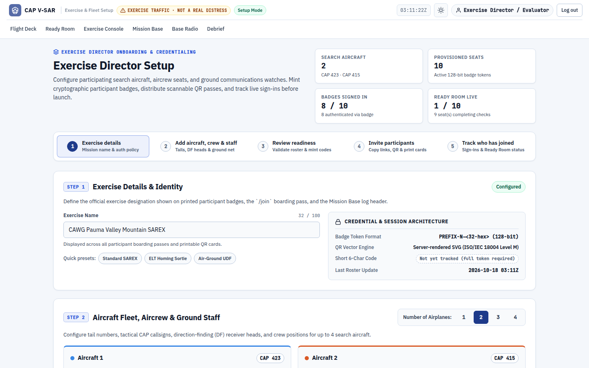
*Figure 1: Exercise Director Setup (`/setup`, Step 1). Look at the top navigation bar (showing all six console links without clipping), the yellow `EXERCISE TRAFFIC · NOT A REAL DISTRESS` banner, the four summary cards on the upper right, and the Exercise Name field set to `CAWG Pauma Valley Mountain SAREX`.*

* **What you will see:**
  * The top bar showing the exercise safety banner, UTC (Zulu) clock, theme toggle (Light/Dark), the Exercise Director's signed-in identity chip (showing `· Google` and your email address when signed in with Google), and links to **Flight Deck**, **Ready Room**, **Exercise Console**, **Mission Base**, **Base Radio**, and **Debrief**.
  * Four summary cards displaying **Search Aircraft**, **Provisioned Seats**, **Badges Signed In**, and **Ready Room Live**.
  * The **Step 1 — Exercise Details & Identity** card with the **Exercise Name** input box and quick preset buttons (`Standard SAREX`, `ELT Homing Sortie`, `Air-Ground UDF`).
* **What you do:**
  1. Type `CAWG Pauma Valley Mountain SAREX` into the **Exercise Name** box (or click a preset button and edit the title).
  2. Confirm the character counter stays between `3` and `100` characters and the status chip on the right reads **Configured** in green.
* **What good looks like:**
  * The status chip shows **Configured** and the feedback line underneath confirms the title will appear on all participant invitations, boarding passes, and printed QR cards.
* **What to do if it doesn't work:**
  * If the status chip turns amber, ensure the exercise name is at least 3 characters long.

---

### Step 2: Configure Aircraft Fleet, Aircrew, Ground Staff, and Per-Seat Google Emails (`/setup` — Step 2)

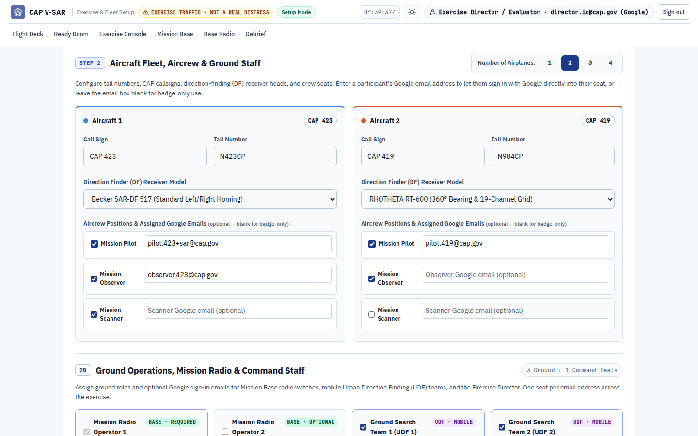
*Figure 2: Exercise Director Setup (`/setup`, Step 2). Look at the signed-in identity chip in the upper right (`Exercise Director / Evaluator · director.ic@cap.gov (Google)`), the Number of Airplanes selector set to `2`, the per-seat Google email boxes under `Aircrew Positions & Assigned Google Emails` (`pilot.423+sar@cap.gov`, `observer.423@cap.gov`, `pilot.419@cap.gov`), and Section 2B below for Ground Operations, Mission Radio, and Command Staff.*

* **What you will see:**
  * A **Number of Airplanes** selector (`1`, `2`, `3`, `4`).
  * One card per aircraft with a color-coded top border (blue for Aircraft 1, orange for Aircraft 2, green for Aircraft 3, amber for Aircraft 4).
  * Inside each aircraft card: **Call Sign**, **Tail Number**, **DF Receiver Model** dropdown (`Becker SAR-DF 517` or `RHOTHETA RT-600`), and checkboxes for **Mission Pilot**, **Mission Observer**, and **Mission Scanner**, each paired with an optional **Google email address** box.
  * Section **2B (Ground Operations, Mission Radio & Command Staff)** with an optional Google email box for the **Exercise Director** (`director.ic@example.org`), plus cards and optional email boxes for **MRO 1** (`mro1@example.org`), **MRO 2**, **UDF 1** (`udf1@example.org`), and **UDF 2**.
* **What you do:**
  1. Click **`2`** next to **Number of Airplanes**.
  2. In **Aircraft 1**, enter Call Sign **`CAP 423`**, Tail Number **`CAP 487`** (or `N423CP`), select **`Becker SAR-DF 517`**, and check **Mission Pilot**, **Mission Observer**, and **Mission Scanner**.
  3. In **Aircraft 2**, enter Call Sign **`CAP 415`** (or `CAP 419`), Tail Number **`N415CP`** (or `N984CP`), select **`RHOTHETA RT-600`**, and check **Mission Pilot** and **Mission Observer**.
  4. **Enter each volunteer's Google email address** in the box for their seat (aircrew seats `PLT`, `OBS`, `SCN`, ground staff `MRO 1`, `MRO 2`, `UDF 1`, `UDF 2`, and the Exercise Director seat):
     * **One seat per email address:** Each email address can be assigned to only one seat in the exercise. If you enter the same email in two seats (for example, both `MRO 1` and `UDF 1`), the setup screen highlights the duplicate in red and refuses to save until each seat has its own unique address.
     * **Exact address matching (dots and `+tags` preserved):** Extra spaces at the start or end are trimmed and uppercase letters are converted to lowercase automatically when you leave the field or save, and the normalized address is shown back in the box. Dots and `+tags` before the `@` sign are kept as part of the address (`j.doe@gmail.com` and `jdoe@gmail.com`, or `pilot.423+sar@example.org` and `pilot.423@example.org`, are treated as distinct addresses, matching how Google verifies them).
     * **Plain ASCII characters only (no accented or special characters):** Email addresses must use plain ASCII letters, numbers, and standard punctuation (`.`, `_`, `-`, `+`, `@`). An address with accented or non-Latin characters is refused with a plain-language message saying so. If a volunteer's Google account address is not plain ASCII, leave their seat's email box empty and hand them a badge code instead.
     * **Leave blank for badge-only seats:** If a volunteer does not have a Google account or will join offline in the field, simply leave their seat's email box empty. That seat will still receive a badge code and QR card.
* **What good looks like:**
  * Every aircraft has a unique callsign, a tail number, a selected DF receiver model, and at least one crew seat checked, and every entered email address shows no red inline error message.
* **What to do if it doesn't work:**
  * If a red validation message appears below an email box, verify that the address uses only plain ASCII characters (no accents or non-Latin characters), has a single `@` sign and a domain containing a dot (such as `@example.org` or `@gmail.com`), and was not entered on another seat.

---

### Step 3: Review Readiness and Save Setup (`/setup` — Step 3)

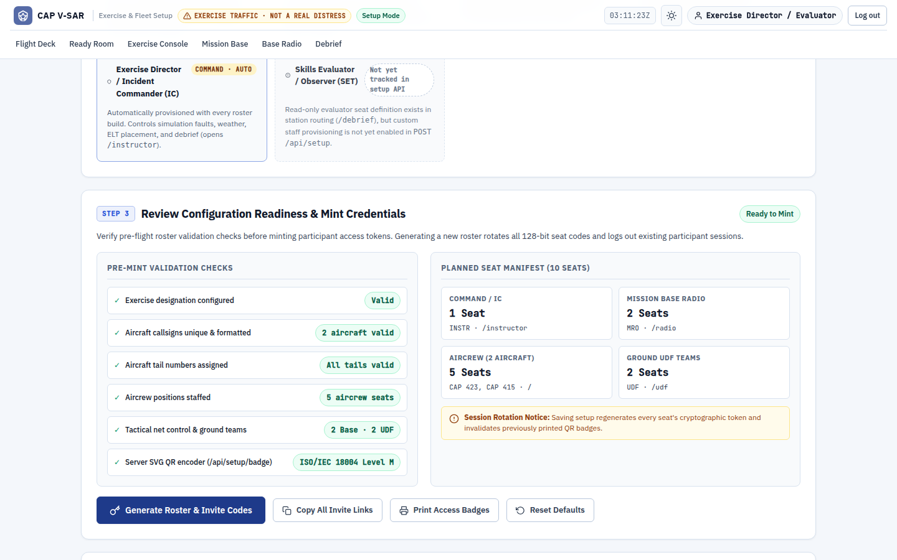
*Figure 3: Exercise Director Setup (`/setup`, Step 3). Look at the green validation checks on the left, the Planned Seat Manifest on the right breaking down the seats by role and destination console, and the primary blue save button. (This screenshot predates the current wording: the heading now reads `Review Configuration Readiness & Save Roster`, the check list `Pre-Save Validation Checks`, the chip `Ready to Save`, and the button `Save Roster & Seat Invites`.)*

* **What you will see:**
  * **Pre-Save Validation Checks** on the left verifying the exercise name, aircraft callsign uniqueness, tail numbers, aircrew seat assignments, email assignments, and ground net watch coverage.
  * **Planned Seat Manifest** on the right summarizing Command, Mission Base, Aircrew, and Ground UDF seats.
  * A yellow **Session Rotation Notice** reminding the director that saving a new setup issues fresh badge codes and signs out everyone else so old sessions cannot linger—while **keeping you (the Exercise Director) signed in** automatically.
* **What you do:**
  1. Confirm the upper-right chip reads **Ready to Save** in green.
  2. Click **Save Roster & Seat Invites**.
* **What good looks like:**
  * Your seat email assignments and backup badge codes are saved, you remain signed in as Exercise Director, and Step 4 populates with the participant invitation list.
* **What to do if it doesn't work:**
  * If the save is refused with a validation banner at the top and a red message under a seat in Step 2 (such as a duplicate or non-ASCII email address), scroll back to Step 2 and correct the highlighted seat.

---

### Step 4: Invite Participants by Email Link and Print Offline Backup Badges (`/setup` — Step 4)

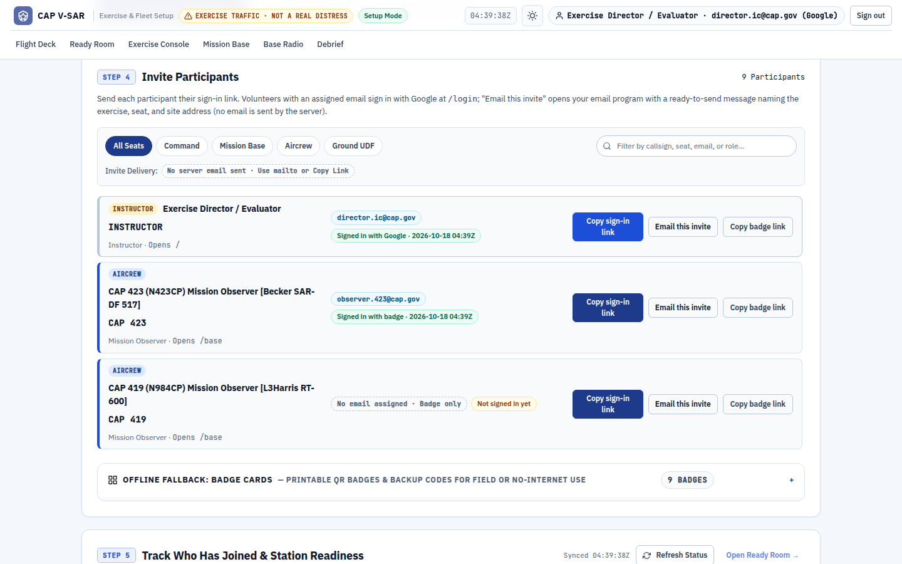
*Figure 4: Exercise Director Setup (`/setup`, Step 4 — Invite Participants). Look at the role filter pills (`All Seats`, `Command`, `Mission Base`, `Aircrew`, `Ground UDF`), the per-seat rows showing assigned emails (`director.ic@cap.gov`, `observer.423@cap.gov`) or `No email assigned · Badge only`, the live sign-in status chips (`Signed in with Google`, `Signed in with badge`, `Not signed in yet`), the `Copy sign-in link`, `Email this invite`, and `Copy badge link` buttons, and the collapsible `OFFLINE FALLBACK: BADGE CARDS` drawer at the bottom.*

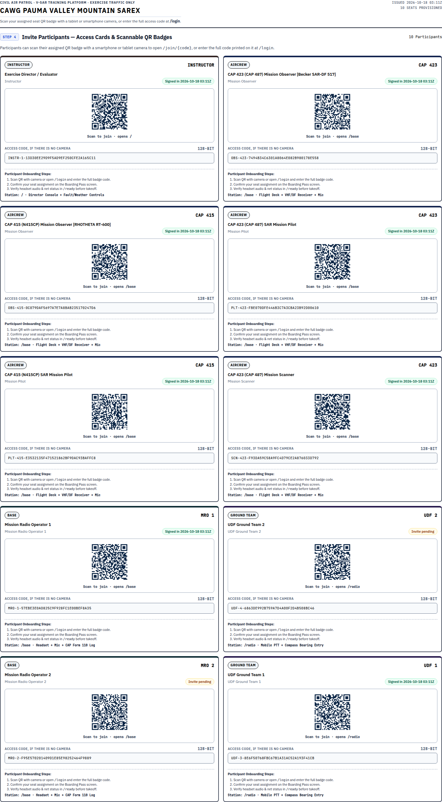
*Figure 5: Printable badge sheet (what the browser prints when you click `Print Offline Badges` in Step 3, or expand the Offline Fallback: Badge Cards section in Step 4 and print the page). Look at the clean two-column card layout with navigation bars removed, high-contrast QR codes, and step-by-step sign-in instructions printed at the bottom of each badge for offline or field use.*

* **What you will see:**
  * **Primary Invite List:** One row per seat showing the role badge (`INSTRUCTOR`, `AIRCREW`, `BASE`, `GROUND TEAM`), seat title and callsign, destination screen (`Opens /`, `Opens /base`, `Opens /radio`), assigned Google email pill (or `No email assigned · Badge only`), and live sign-in status chip.
  * **Invite Delivery Notice:** Explicitly labeled **`No server email sent · Use mailto or Copy Link`**. The simulator server never sends automated background emails; you control when and how invitations are sent.
  * **Collapsible Offline Fallback Drawer:** At the bottom of Step 4 is the **`OFFLINE FALLBACK: BADGE CARDS — PRINTABLE QR BADGES & BACKUP CODES FOR FIELD OR NO-INTERNET USE`** section, which keeps the badge cards and QR codes tucked neatly out of the way until needed.
* **What you do:**
  1. **To invite a volunteer by email (`Email this invite`):** Click **Email this invite** on their row. This opens your computer's own email program with a pre-filled message; the console sends nothing itself. What the pre-filled message contains depends on how the seat is configured:
     * **A seat assigned by email:** Sends **only** the `/login` sign-in page address, the seat/role and callsign in plain words, and the 3 sign-in steps (*open the sign-in page, click Sign in with Google with that address, and complete the Ready Room check*). **It includes no badge code and no `/join/...` join link**—the seat is tied to that email address, and a badge code is a credential that should not travel by email.
     * **A badge-only seat (no email assigned):** Sends the direct `/join/{code}` join link and the badge code, as before, because that is the only way into a badge-only seat.
     * **The Exercise Director (`INSTR-1`) seat:** **Never** includes the director's badge code, whether or not an email is assigned; the Exercise Director's code stays strictly on the printed card.
  2. **To share a link in chat:** Click **Copy sign-in link** to copy the `/login` address for an email-assigned seat (or **Copy badge link** on the same row to copy that seat's `/join/{code}` badge link; share badge links only for badge-only seats) to your clipboard.
  3. **To prepare for an offline / field SAREX (no internet at the ESCON site):** Click the **Offline Fallback: Badge Cards** bar to expand the badge grid, or click **Print Offline Badges** in Step 3 to print the two-column badge sheets (`Figure 5`) and hand each member their physical slip.
* **What good looks like:**
  * Clicking **Copy sign-in link** or **Copy badge link** briefly shows **`Copied!`** in green, and clicking **Email this invite** opens a pre-addressed draft in your email client with the exact instructions for that seat.
* **What to do if it doesn't work:**
  * If a QR image inside the offline fallback drawer does not load, verify you opened `/setup` using the same network address that participants will use to reach the station.

---

### Step 5: Track Who Has Joined and How They Signed In (`/setup` — Step 5)

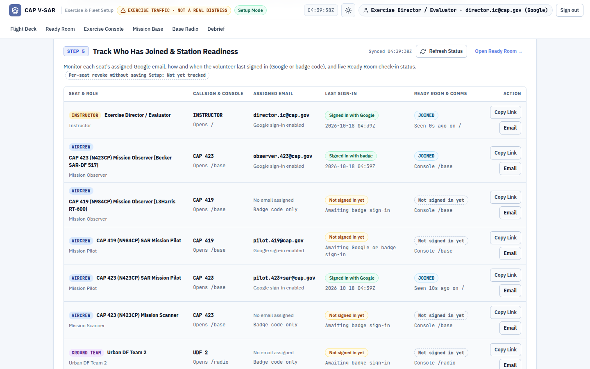
*Figure 6: Exercise Director Setup (`/setup`, Step 5). Look at the `ASSIGNED EMAIL` column showing each seat's Google address (or `No email assigned · Badge code only`), the `LAST SIGN-IN` column distinguishing `Signed in with Google` and `Signed in with badge` (with UTC timestamps) from `Not signed in yet`, and the `READY ROOM & COMMS` column.*

* **What you will see:**
  * A live attendance table listing every seat across six columns:
    1. **Seat & Role:** Position title and role badge (`INSTRUCTOR`, `AIRCREW`, `BASE`, `GROUND TEAM`).
    2. **Callsign & Console:** Tactical callsign (`CAP 423`, `MRO 1`, `UDF 1`) and destination console (`Opens /`, `Opens /base`, `Opens /radio`).
    3. **Assigned Email:** The Google email address assigned to that seat (or `No email assigned · Badge code only`). *(For privacy, participant email addresses are shown only to the Exercise Director / Instructor; other participants never see each other's email addresses.)*
    4. **Last Sign-In:** Shows **`Signed in with Google`** (green chip + UTC timestamp, such as `2026-10-18 04:39Z`), **`Signed in with badge`** (green chip + UTC timestamp), or **`Not signed in yet`** (amber chip).
    5. **Ready Room & Comms:** Live station check-in state (`JOINED` and when the member was last seen on their console).
    6. **Action:** Quick **Copy Link** and **Email** buttons to re-send an invitation.
* **What you do:**
  1. Watch the **Last Sign-In** column as aircrews and base staff sign in with Google or with their backup badge codes.
  2. For any member still showing **Not signed in yet**, click **Email** or **Copy Link** on the right side of their row to send a reminder.
  3. Click **Open Ready Room** once participants have signed in.

---

## 5. Phase 2: Participant Sign-In (Google & Offline Badge), Boarding Pass, and Ready Room (`/login`, `/join`, `/ready`)

### 5.1 Signing In with Google at `/login` (Primary Path)

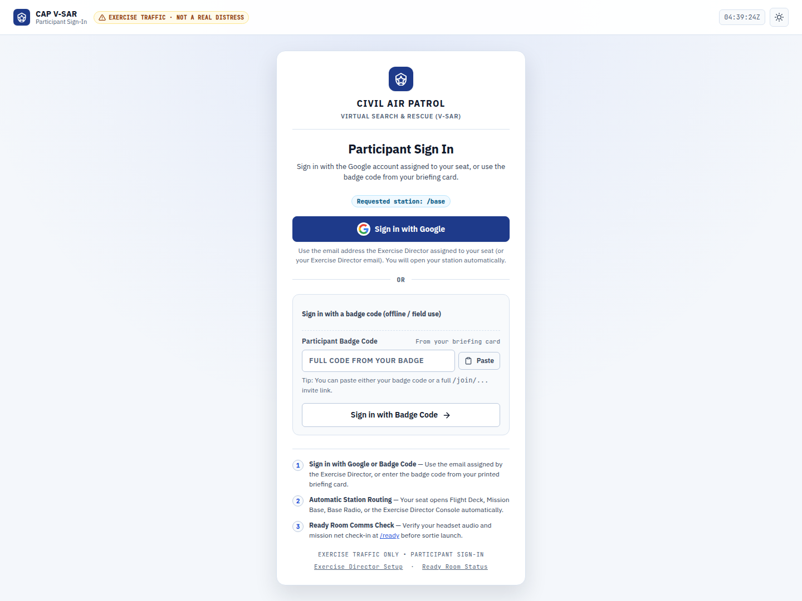
*Figure 7: Participant Sign-In gateway (`/login`) when Google sign-in is enabled. Look at the prominent blue `Sign in with Google` button at the top, the requested destination pill (`Requested station: /base`), the `OR` divider, and the secondary `Sign in with a badge code (offline / field use)` card below.*

* **What you will see:**
  * At the top of the **Participant Sign In** card: a prominent blue **Sign in with Google** button and a note explaining that you should use the Google email address the Exercise Director assigned to your seat.
  * Below the **`OR`** divider: a secondary **Sign in with a badge code (offline / field use)** box for field sites without internet or seats without an assigned email.
* **What you do:**
  1. Open `/login` from the invitation link sent by your Exercise Director.
  2. Click **Sign in with Google** and choose the Google account that matches the email address your Exercise Director entered for your seat in `/setup`.
  3. Once Google verifies your account, the console automatically signs you into your seat and opens the screen for your role:
     * **Mission Pilot, Mission Observer, Mission Scanner (`CAP 423`, `CAP 415`):** Opens `/base` (and `/ready` for pre-flight checks).
     * **Mission Radio Operator (`MRO 1`, `MRO 2`):** Opens Mission Base (`/base`); open **Base Radio** (`/radio`) for the headset radio and `/ready` for checks.
     * **Ground UDF Teams (`UDF 1`, `UDF 2`):** Opens Base Radio (`/radio`).
     * **Exercise Director / Incident Commander (`IC`):** Opens the Participant Home portal (`/`) or returns directly to `/setup` / `/instructor`.
  4. **Signing Out or Switching Seats in the Same Browser:** While signed in, the top bar displays your callsign, role, and **`· Google`** inside your identity chip. Clicking that identity chip (or clicking **Sign out** on `/setup`) ends your simulator session and returns you to `/login` so another volunteer can sign in. *(Signing out of the simulator console does not sign you out of your Google account itself.)* In addition, **signing in again from a browser that is already signed in** (whether via Google or a badge code, and for any seat) automatically ends and replaces that browser's previous sign-in session across all open tabs—without affecting any other computer or tablet signed into the same seat.
* **What good looks like:**
  * One click on **Sign in with Google** lands you directly on your assigned station with a session that lasts 24 hours by default—no code typing required.

---

### 5.2 What to Do If You See "There Is No Seat for You" or Sign In with the Wrong Account

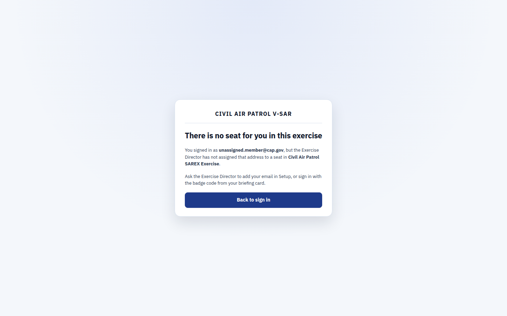
*Figure 8: No-Seat Assigned screen (`There is no seat for you in this exercise`). Look at the exact Google email address shown in bold (`unassigned.member@cap.gov`), the exercise name, the plain-language explanation, and the blue `Back to sign in` button.*

* **What you will see and how to fix it:**
  1. **"There is no seat for you in this exercise" (`Figure 8`):**
     * **Why it happens:** Google verified your email address (shown in bold on the card, such as `unassigned.member@cap.gov`), but that address does not match any seat in the current exercise roster. Usually this means (a) your browser used a different Google account from the one your Exercise Director assigned (for example a personal account instead of your wing account), (b) the Exercise Director has not yet entered your email in `/setup` Step 2 (or had a spelling typo), or (c) your Google account address contains accented or non-Latin characters (seat emails must be plain ASCII).
     * **What to do:**
       * If you picked the wrong Google account: click **Back to sign in**, click **Sign in with Google** again, and select the Google account your Exercise Director assigned to your seat (or open a private/incognito window so Google asks which account to use).
       * If the Exercise Director needs to add or fix your email: tell the Exercise Director the exact plain-ASCII email address shown in bold on your screen so they can enter it in `/setup` Step 2 and click **Save Roster & Seat Invites**—or simply sign in right away using the badge code from your briefing card on `/login`. *(Note: A failed or no-seat sign-in attempt does not disturb an existing active session in your browser.)*
  2. **"Sign-in was cancelled" banner on `/login`:**
     * Appears if you closed or cancelled the Google account chooser. Click **Sign in with Google** again when ready.
  3. **"Google sign-in did not complete" or "The sign-in provider could not be reached":**
     * Appears if a sign-in redirect link was copied from one browser to another (each sign-in attempt is bound to the browser that started it and expires after 10 minutes), or if the training site lost internet connectivity to Google. Click **Sign in with Google** to start a fresh sign-in in the same browser, or use your badge code below the divider if internet service is down.
  4. **"Too many sign-in attempts, try again in a minute":**
     * Appears if more than 10 failed Google sign-in attempts arrive from the same network address within 60 seconds. Wait one minute and try again, or sign in with your badge code.

---

### 5.3 Signing In with a Badge Code or QR Card — Offline and Field Fallback (`/login` and `/join/{code}`)

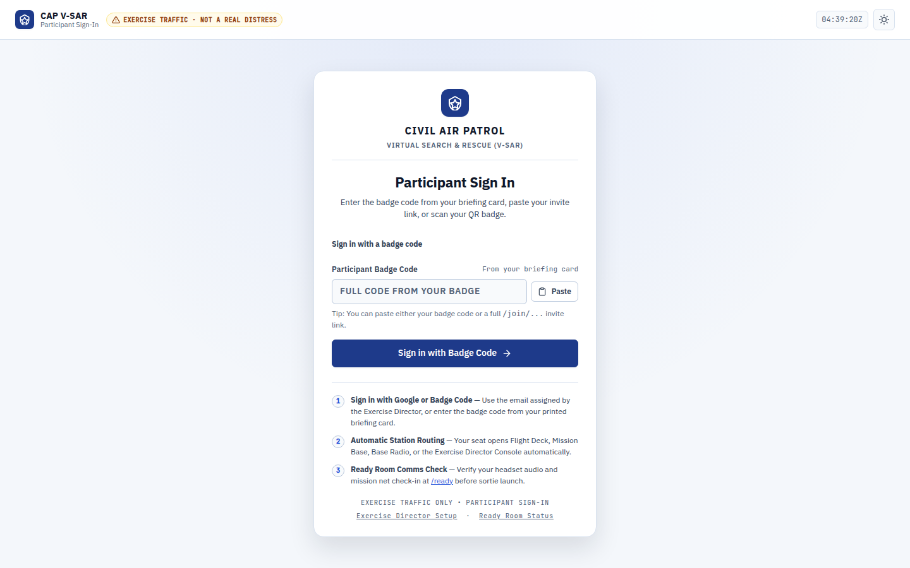
*Figure 9: Participant Sign-In gateway (`/login`) in offline / field mode. When the console runs without internet or without Google sign-in configured, the Google button is hidden automatically and only the badge code form is displayed.*

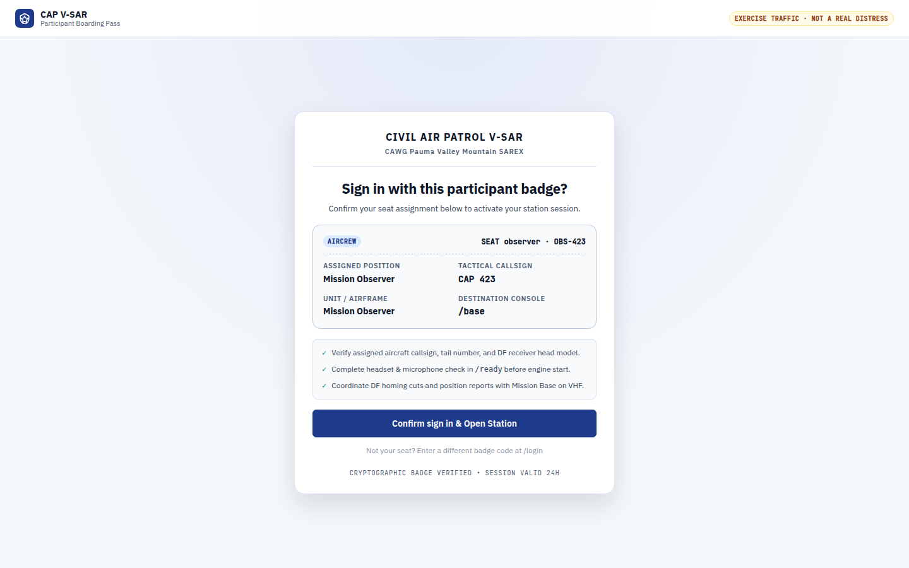
*Figure 10: Participant Boarding Pass (`/join/{code}`) on a desktop browser (1440×900). Look at the exercise name (`CAWG Pauma Valley Mountain SAREX`), the role pill (`AIRCREW`), the seat and prefix (`SEAT observer · OBS-423`), the assigned position (`Mission Observer`), tactical callsign (`CAP 423`), destination console (`/base`), and the 3-item pre-flight checklist.*

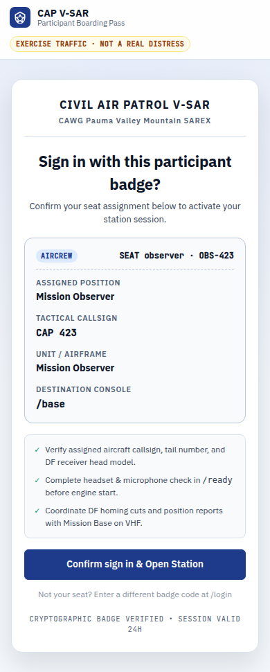
*Figure 11: Participant Boarding Pass (`/join/{code}`) on a mobile phone screen (390×844) after scanning a QR badge. Look at how the seat fields stack into a single vertical column and the confirmation button spans the width of the screen.*

* **When to use the badge-code fallback:**
  * Use a badge code or printed QR card whenever the training room or field command post (such as an off-grid ESCON briefing site) has no internet access to Google, or when a participant's seat was left as badge-only in `/setup`.
* **What you do:**
  1. **Using a QR card or `/join/{code}` link (`Figures 10 & 11`):** Scan the QR code on your printed badge card (or open your `/join/...` link), verify that **Assigned Position** and **Tactical Callsign** match your **ICS 204** assignment, and click **Confirm sign in & Open Station**. *(Opening the `/join` preview link does not sign you in until you click the confirmation button, so chat apps that preview links will not accidentally consume your sign-in.)*
  2. **Typing or pasting a badge code on `/login` (`Figures 7 & 9`):** Paste your full badge code (or full `/join/...` invite link—the box extracts the code automatically) into the **Participant Badge Code** field and click **Sign in with Badge Code**.
* **What good looks like:**
  * Your browser stores a station session (24 hours by default, replacing any previous sign-in in that browser without affecting other devices on the same seat) and opens your assigned console (or the **Participant Home** portal `/` shown in `Figure 12`).
* **What to do if it doesn't work:**
  * **Common mistake:** Typing only the short role prefix (such as `OBS-423` or `MRO-1`) without the secret characters after the second hyphen. Always paste the complete badge code printed on your card.
  * If you see **That badge code was not recognized or was replaced when the Exercise Director updated the roster**, the Exercise Director has saved a new setup in `/setup` (which rotates all badge codes). Ask the Exercise Director for your updated badge code or sign in with Google.

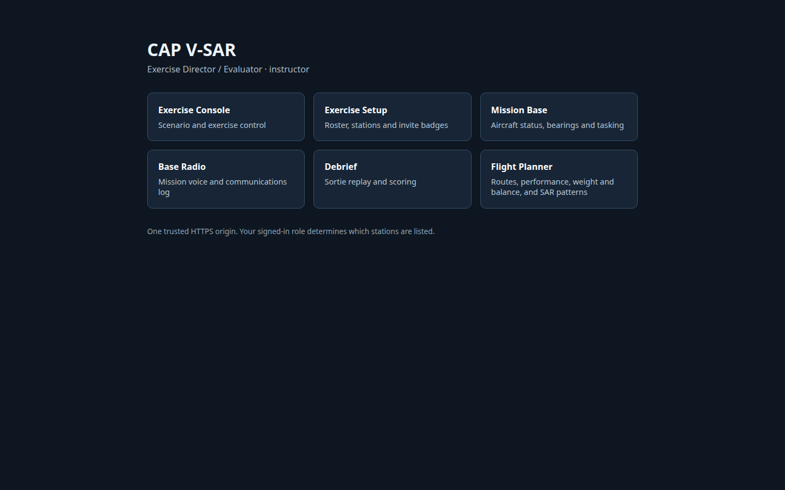
*Figure 12: Participant Home Portal (`/`). Look at the role header at the top and the clickable station cards (`Exercise Console`, `Exercise Setup`, `Mission Base`, `Base Radio`, `Debrief`, and `Flight Planner`).*

---

### 5.4 Completing Pre-Flight Checks in the Ready Room (`/ready`)

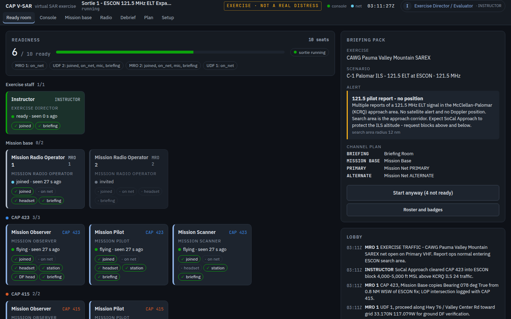
*Figure 13: Ready Room (`/ready`). Look at the overall readiness bar (`6 / 10 ready`), the seat tiles grouped by unit (`Exercise staff`, `Mission base`, `CAP 423`, `CAP 415`), the individual green check pills (`joined`, `headset`, `station`, `DF head`, `briefing`), and the `BRIEFING PACK` on the right showing Scenario `C-1 Palomar ILS - 121.5 ELT at ESCON`.*

* **What you will see:**
  * **Left and Center:** Seat tiles grouped by **Exercise staff**, **Mission base**, **`CAP 423`** (blue dot), **`CAP 415`** (orange dot), and **Ground team**. Each tile shows whether the participant has signed in (via Google or badge code) and the checks required for that seat:
    * `joined`: Signed in with Google or badge code.
    * `on net`: Connected to the voice radio net.
    * `headset` (`mic`): Headset and microphone tested.
    * `station`: Flight simulator reporting aircraft position (aircrew seats only).
    * `DF head`: Direction-finding receiver powered on in the cockpit (Mission Observer seats only).
    * `briefing`: Briefing pack read and confirmed.
  * **Right Column (`BRIEFING PACK`):** Shows the exercise name, the scenario (`C-1 Palomar ILS - 121.5 ELT at ESCON · 121.5 MHz`), the alert text (*Multiple reports of a 121.5 MHz ELT signal in the McClellan-Palomar (KCRQ) approach area...*), the voice channel plan (`Briefing Room`, `Mission Base`, `Mission Net PRIMARY`, `Mission Net ALTERNATE`), and the live **LOBBY** message feed.
* **What you do:**
  1. Read the **ALERT** and **CHANNEL PLAN** in the right-hand **BRIEFING PACK** panel.
  2. Test your headset and microphone on the radio net, then click **Headset tested on the radio page** and **I have read the briefing** on your seat tile.
  3. If you are the **Mission Observer** on `CAP 423` or `CAP 415`, turn on your cockpit DF receiver (**Becker SAR-DF 517** or **RHOTHETA RT-600**) so the `DF head` pill on your tile turns green.
* **What good looks like:**
  * Every check pill on your seat tile is green, and your seat status changes to **`ready`** (or **`flying`** once the sortie begins).
* **What to do if it doesn't work:**
  * If `station` stays gray on an aircrew tile, the flight simulator for that callsign is not yet sending position reports.
  * If `DF head` stays gray or red on the Mission Observer tile, verify the cockpit **Mission Master Switch** is ON, the DF circuit breaker is pushed in, and the DF receiver power switch is set to ON.

---

## 6. Phase 3: Pre-Flight Mission Planning and Search Patterns (`/planner/`)

Before launch, the **Air Operations Branch Director (AOBD)** and **Mission Observer / Mission Pilot** use the **Flight Planner** (`/planner/`) to build the search pattern assigned on the **ICS 204** and load it into the aircraft's Garmin G1000.

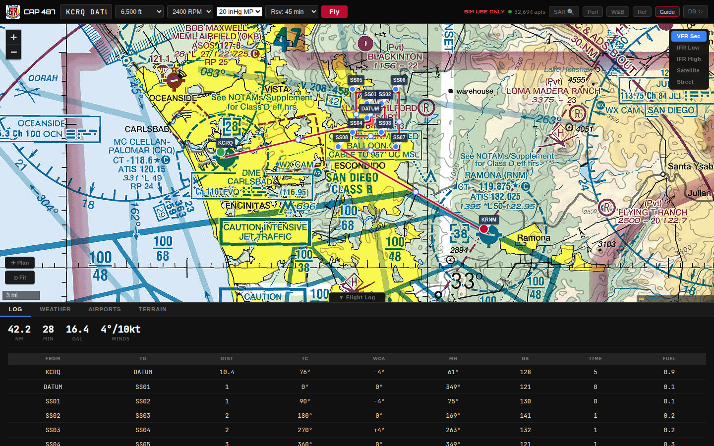
*Figure 14: Flight Planner (`/planner/`) after the SAR Pattern generator's **Apply to Route**. Look at the route drawn through the expanding-square legs with the labelled `DATUM`, `SS01` … `SS08` waypoints east of Escondido on the VFR Sectional, the departure `KCRQ` and destination `KRNM` either side of the pattern, the chart selector on the right (`VFR Sec`, `IFR Low`, `IFR High`, `Satellite`, `Street`), and the nav log below listing every leg (`KCRQ` to `DATUM` is `10.4 NM` on `076°` true, the ESCON fix geometry).*

### 6.1 Supported CAP Search Patterns

The Flight Planner generates three standard CAP electronic and visual search patterns using geodetic coordinates that match the G1000 search library within 25 meters:

1. **Expanding Square (`SS` — Used in Scenario C-1 at ESCON):**
   * Anchored directly on a **Datum** point (`ESCON`: `33.1700° N, 117.0792° W`).
   * Leg lengths grow in pairs (`S, S, 2S, 2S, 3S, 3S...`) with `90°` turns (default **Right** turns).
   * Waypoints are named `DATUM`, `SS01`, `SS02`, ... up to `SS08` (9 waypoints total for the ESCON search).
   * Best used when homing onto a point datum (such as the ESCON fix or a point of overhead station passage) to localize an ELT.
2. **Parallel Track (`PS`):**
   * Sweeps a rectangular search box along its major axis with uniform lane spacing `S`.
   * Waypoints are named `PS01`, `PS02`, ... (2 waypoints per lane).
3. **Creeping Line (`CS`):**
   * Sweeps perpendicular to an intended flight route or valley corridor between a start point and an end point.
   * Waypoints are named `CS01`, `CS02`, ... across the track axis.

### 6.2 Building and Exporting the ESCON Expanding Square

* **What you will see:**
  * A VFR Sectional / terrain map centered on northern San Diego County (`KCRQ` — `ESCON` — `KRNM`), a route table, weight-and-balance calculator, terrain clearance profile, and the **SAR Pattern** generator dialog.
* **What you do:**
  1. Open **Flight Planner** (`/planner/`), acknowledge the **Simulation use only** notice, type the departure and destination airports in the route box (`KCRQ KRNM`), set the cruise altitude in the top bar, then click **SAR** and the **Expanding Sq (SS)** tab.
  2. Enter Datum **`@33.1700,-117.0792`** (`ESCON`; a fix or airport identifier also works), Track Spacing **`1.0`** NM, Search Legs **`8`** (producing 9 waypoints: `DATUM` through `SS08`), Initial Heading **`0`** °T, and Turn Direction **`Standard Right (90°)`**. Click **Preview on Map** to see the legs and the distance, time and fuel summary, then **Apply to Route** to insert the pattern between the departure and destination airports (`Figure 14`).
  3. Inspect the terrain elevation profile at the bottom of the screen to confirm at least `1,000 ft AGL` terrain clearance across all legs and note the rising Ramona ridge (`3,977–4,526 ft MSL`) immediately east of the pattern.
  4. Reopen **SAR** and click **Export X-Plane .FMS** to save the flight plan file for the Garmin G1000 (maximum 99 total waypoints per `.fms` file, or 97 search waypoints plus departure and destination airports). **Push to V-SAR Console** sends the same pattern to the Mission Base map.
* **What good looks like:**
  * The 9-waypoint expanding square appears over the ESCON fix on the KCRQ ILS Runway 24 approach course, and the exported `.fms` file loads cleanly into the cockpit G1000 Flight Plan (`FPL`) catalog.
* **What to do if it doesn't work:**
  * If **Export X-Plane .FMS** refuses the pattern, reduce the number of legs so the total flight plan stays at or below 99 waypoints (the G1000 flight plan limit).

---

## 7. Phase 4: Mission Base Operations and Radio Procedure (`/base`, `/radio`)

Once aircrews complete their Ready Room checks and launch, **Mission Base** coordinates the search from `/base` and `/radio`.

### 7.1 Operating the Mission Base Map and Bearing Plotter (`/base`)

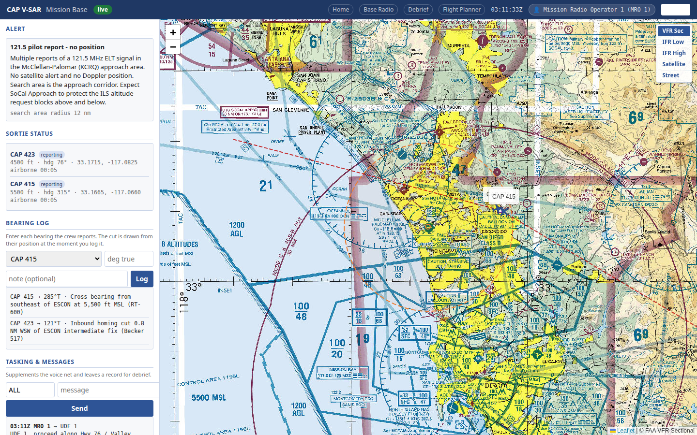
*Figure 15: Mission Base Console (`/base`) signed in as `MRO 1`. Look at the `ALERT` panel on the upper left (showing the 121.5 MHz pilot report with no satellite position), the `SORTIE STATUS` panel showing `CAP 423` at 4,500 ft and `CAP 415` at 5,500 ft, the `BEARING LOG` with two logged true bearings, and the red dashed lines of position (LOPs) on the VFR Sectional chart intersecting northeast of Carlsbad at ESCON.*

* **What you will see:**
  * **Left Sidebar:**
    * **ALERT:** Displays the mission alert text (*Multiple reports of a 121.5 MHz ELT signal in the McClellan-Palomar (KCRQ) approach area...*) and the `12 NM` search area circle (orange dashed ring on the map). **Note:** The true ELT location is strictly hidden from Mission Base until the Exercise Director reveals it for debrief.
    * **SORTIE STATUS:** Live position, altitude (`ft`), true heading (`hdg`), and airborne timer for **`CAP 423`** and **`CAP 415`**.
    * **BEARING LOG:** Input boxes for aircraft **callsign**, reported bearing (**`deg true`**), and **note (optional)**, plus the list of logged cuts.
    * **TASKING & MESSAGES:** Written coordination messages between Mission Base, aircraft, and ground teams.
  * **Center Map:** Aeronautical chart switcher in the upper right (**VFR Sec**, **IFR Low**, **IFR High**, **Satellite**, **Street**), live aircraft icons rotated to their true headings, and red dashed **Lines of Position (LOPs)** drawn from each aircraft's exact position at the moment a bearing was logged.
* **What you do:**
  1. When `CAP 423` or `CAP 415` calls in a DF bearing over the radio (for example: *"Mission Base, CAP 423, bearing 078 degrees true from present position, strong 121.5 warble"*), select **`CAP 423`** in the **BEARING LOG**, type **`78`** in **`deg true`**, add a brief note (`Inbound homing cut 0.8 NM WSW of ESCON`), and click **Log**.
  2. When **`CAP 415`** reports a cross-bearing from the southeast (`332°` or `285°` true), log that cut the same way.
  3. Inspect where the red dashed lines of position intersect on the VFR Sectional chart. Look for any bearing that points wildly away from previous cuts—a classic sign of a **multipath reflection** off the Ramona ridge or a **cone-of-confusion** swing near the beacon.
  4. Once two or more reliable cuts intersect near the ESCON fix (`33.170° N, 117.079° W`), transmit and log a tasking message dispatching **`UDF 1`** along Highway 76 / Valley Center Road to verify and locate the beacon on the ground.
* **What good looks like:**
  * Each logged bearing immediately draws a red dashed line across the chart from the reporting aircraft's position, and two or more cuts form a tight triangle around the ESCON fix.
* **What to do if it doesn't work:**
  * Confirm the crew is reporting **True** bearing (or convert Magnetic to True by adding the local `11° East` magnetic variation at KCRQ/ESCON before logging: True = Magnetic + 11 degrees).
  * If an aircraft drops off the live status list while its simulator is silent, you can still log a delayed bearing report—Mission Base automatically anchors the cut to that aircraft's last recorded position in the sortie.

---

### 7.2 Operating the Mission Base Radio and CAP Form 110 Log (`/radio`)

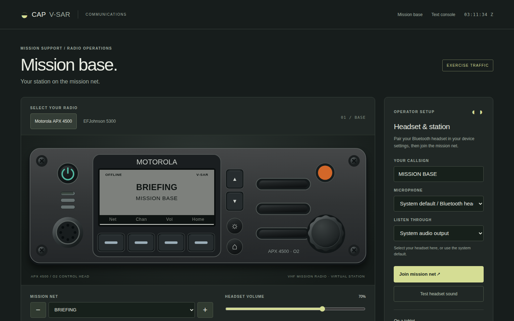
*Figure 16: Mission Base Radio Console (`/radio`). Look at the tactical VHF-FM radio control head, the channel/zone display, the Push-to-Talk (PTT) control, and the communications log panel.*

* **What you will see:**
  * The **Mission Base Headset Radio** (`/radio`) replicating the **Motorola APX 4500 / EFJohnson 5300** tactical VHF-FM transceiver with live voice channels (**Briefing Room**, **Mission Base**, **Mission Net PRIMARY**, **Mission Net ALTERNATE**, **Aircraft Intercoms**, and **Instructor - SET**).
  * A **Monitor (`MON`)** button to open squelch for weak signals in mountainous terrain, a **Push-to-Talk (`PTT`)** button (also activated by holding the **Spacebar**), and a **60-second transmitter time-out timer** that prevents a stuck microphone from blocking the net.
  * The **CAP Form 110** log panel on the same page, with Zulu timestamps, quick-entry buttons (**`Ops Normal`**, **`Radio Check`**), and an **Export CAPF-110** action that saves the log for Incident Command. The earlier text-message training console remains available at `/radio-legacy`.
* **What you do:**
  1. Select **Mission Net PRIMARY** (`TAC 1`) and perform a pre-flight radio check with **`CAP 423`**, **`CAP 415`**, and **`UDF 1`** using standard **CAPR 100-3** prowords (`ROGER`, `OVER`, `OUT`, `SAY AGAIN`; never use 10-codes).
  2. Begin all tactical exercise transmissions with **"EXERCISE TRAFFIC"**.
  3. Record every **30-minute Ops Normal** call from airborne aircraft (example: *"MISSION BASE, CAP 423, EXERCISE TRAFFIC, OPS NORMAL, ESCON EXPANDING SQUARE LEG 4, 4,500 FEET, FUEL 3.5 HOURS REMAINING"*).
* **What good looks like:**
  * Pressing PTT produces the standard 3-tone P25 talk-permit chirp, your transmission is heard clearly by aircrews on COM3, and every significant event is timestamped in Zulu time on the **CAP Form 110** log.
* **What to do if it doesn't work:**
  * If your browser blocks microphone access, verify you opened the station over `https://` and granted microphone permission when prompted.
  * If you transmit continuously for 60 seconds, the transmit gate automatically unkeys your microphone to protect the net; release PTT for 1 second before keying again.

---

## 8. Phase 5: Airborne Search, Direction Finding, and the AI Mission Pilot

### 8.1 Cockpit Avionics and the Mission Observer Station

In the **Cessna 182T NAV III (`CAP 487`)** and **Cessna 172SP**, the right-seat **Mission Observer (MO)** operates four dedicated SAR instruments alongside the Garmin G1000 Multi-Function Display (MFD):

1. **CAP Mission Master Switch & Observer Circuit Breaker Panel:**
   * A guarded master switch and individual pullable circuit breakers that control electrical power to the tactical FM radio and direction finder.
2. **Garmin GMA 1347 Audio Panel (`COM1` / `COM2` / `COM3` & Intercom Isolation):**
   * Routes audio and microphone selection between **COM1** (VHF-AM for SoCal Approach / ATC), **COM2** (VHF-AM air-to-air / `123.100 MHz` SAR), and **COM3** (the **Technisonic TDFM-136B** VHF-FM tactical radio).
   * **CRITICAL TRAINEE TRAP (`COM3` Audio vs. `COM3 MIC`):** Pressing the top `COM3` button only lets you **hear** Mission Base. To **talk** on the tactical FM radio, you **must** press **`COM3 MIC`**. Nearly every in-flight report that *"the FM radio isn't transmitting"* is caused by `COM3` audio being selected while `COM1 MIC` or `COM2 MIC` is still active.
   * **Cockpit Intercom Isolation (`PILOT` / `CREW` / `ALL`):** When `CAP 423` negotiates altitude block clearances with **SoCal Approach** over the KCRQ ILS Runway 24 approach course, selecting **`PILOT`** isolation lets the Mission Pilot focus on ATC on COM1 while the Mission Observer continues coordinating DF cuts with Mission Base on COM3.
   * **Clearance Recorder (`PLAY`):** Replays the last 2.5 minutes of incoming radio calls if a grid coordinate or altitude block clearance was missed.
3. **Technisonic TDFM-136B VHF-FM Tactical Radio:**
   * Covers `136.0000–174.0000 MHz` (analog FM and P25 digital) with 200 programmed CAP channels (`TAC 1`, `TAC 2`, `CC 1`, `AIR 1`, `SAR 1`, `VFIRE 21`, `VTAC 11`, `CALCORD`) plus a continuous **Guard Receiver** monitoring `168.650 MHz` (`AIRGUARD`) or `121.500 MHz`.

---

### 8.2 Operating the Becker SAR-DF 517 (`CAP 423`) and RHOTHETA RT-600 (`CAP 415`)

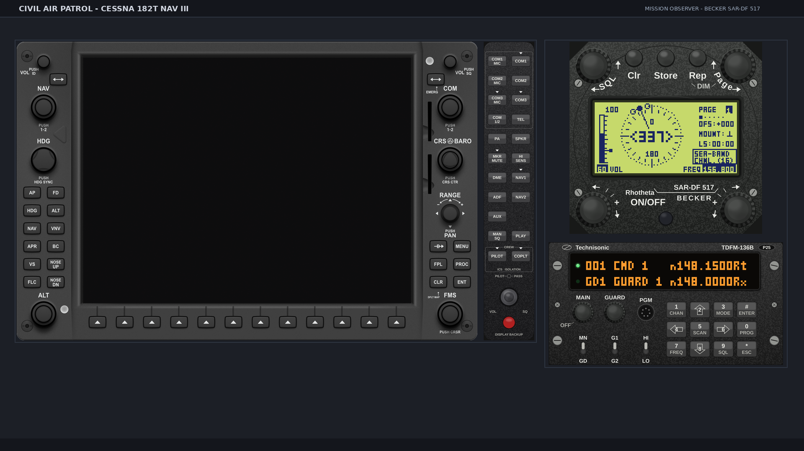
*Figure 17: Becker SAR-DF 517 Airborne Direction Finder Control Head (`CAP 423`). Look at the 128×64 dot-matrix LCD showing the 360° bearing pointer, relative bearing readout, signal strength bar, squelch (`SQL`) control, and the `STORE` and `CLR` function keys.*


*Figure 18: RHOTHETA RT-600 Airborne Direction Finder Control Head (`CAP 415`). Look at the circular compass rose, the active frequency and COSPAS-SARSAT group readout (`CPSAR`), signal quality indicators, and front-panel rotary controls.*

#### Comparing the Two Fleet Direction Finders

| Feature | Becker SAR-DF 517 (`CAP 423`) | RHOTHETA RT-600 (`CAP 415`) |
| :--- | :--- | :--- |
| **121.5 / 243.0 MHz Homing** | Continuous pseudo-Doppler bearing + 3 kHz audio tone | Continuous multi-band Doppler bearing + dual-watch scan |
| **406 MHz COSPAS-SARSAT Coverage** | **Emergency Mode:** Fixed single channel (`406.025 MHz` only). **Training Mode:** Tunable across `400–410 MHz` (`406.022`, `.025`, `.028`, `.037`). | **Full 19-Channel Grid:** Covers all 19 COSPAS-SARSAT channels (`406.022–406.076 MHz`) across 7 selectable `CPSAR` groups (`A`–`S`). |
| **Course-Change Averaging (`CLR`)** | 2-second circular averaging window; press **`CLR`** after completing a turn to clear turn-induced bearing drag. | 2-second averaging window with spread quality bar; press **`CLR`** after turns to reset the filter. |
| **Overhead Tone Suppression (`STORE`)** | Pressing **`STORE`** removes the receiver's 3 kHz DF tone while keeping the raw 121.5 MHz warble audible for overhead aural-null homing. | Displays signal strength, spread quality, and holds 406 MHz burst bearings for 50 seconds (`TIMEHOLD`). |
| **Antenna Mounting (`TOP` / `BOTTOM`)** | Must match airframe belly antenna (`BOTTOM` on C182T); wrong setting mirror-inverts left/right bearings. | Models attitude-dependent **wing blanking** (up to 24 dB loss when banked). |

#### Step-by-Step Airborne DF Procedure in the ESCON Expanding Square

* **What you will see:**
  * As `CAP 423` enters the ESCON search area at `4,500 ft MSL` (above the `3,300 ft MSL` KCRQ ILS traffic block), the Becker SAR-DF 517 tuned to `121.500 MHz` opens squelch, plays the downward-sweeping ELT warble mixed with the 3 kHz DF tone, and points its circular needle toward the beacon.
* **What you do:**
  1. **Verify Setup:** Confirm the Mission Master Switch is ON, the Becker 517 / RT-600 is tuned to **`121.500 MHz`**, antenna mounting is set to **`BOTTOM`** (belly antenna), and squelch (`SQL`) is set just above background static.
  2. **Fly Straight and Wings-Level Before Calling a Cut:** Because the receiver averages bearings over a 2-second window and aircraft bank angles can shadow the belly antenna (**wing blanking**), roll wings-level for at least 3–5 seconds and press **`CLR`** after any `90°` pattern turn before reading the bearing.
  3. **Convert or Read True Bearing:** Add your relative DF pointer angle to the aircraft's heading (or read the true bearing when stabilized) and report the cut to Mission Base on COM3 (`TAC 1`):
     * *"Mission Base, CAP 423, Exercise Traffic, Leg 3 abeam ESCON, 4,500 feet, bearing 078 degrees true from present position, strong 121.5 warble, over."*
  4. **Resolve Ambiguity with a Wing Dip (if needed):** If you suspect a reciprocal bearing or reflection off the Ramona ridge, bank `20°` toward the suspected beacon side; the raised opposite wing shields the belly antenna (up to `24 dB` signal drop), confirming which side the beacon lies on.
  5. **Recognize the Cone of Confusion and Mark Overhead Passage:** Within roughly `0.35 NM` of the ESCON fix (`33.1700° N, 117.0792° W`) at `4,500 ft MSL` (the cone is `30°` wide above the beacon, so it is tighter lower down), the DF needle will swing rapidly and the spread indicator will widen (**cone of confusion**). On the Becker 517, press **`STORE`** to silence the 3 kHz tone and listen to the raw 121.5 MHz warble peak and null directly beneath the aircraft. Call **"OVERHEAD THE BEACON"** to Mission Base and record the GPS coordinates from the G1000.
* **What good looks like:**
  * Bearing cuts taken wings-level on straight legs of the ESCON expanding square agree within `2°–5°` of the true beacon position and converge cleanly on the Mission Base chart.
* **What to do if it doesn't work:**
  * **Left/Right bearings are reversed:** Check the DF receiver's antenna mounting setting (`TOP` vs `BOTTOM`). A belly antenna set to `TOP` mirror-inverts every left/right turn.
  * **No 406 MHz signal on Becker 517 while `CAP 415` hears it on the RT-600:** In Emergency mode, the Becker 517 only listens to `406.025 MHz`. If the exercise uses another 406 MHz channel (such as `406.037 MHz`), switch the Becker 517 to **Training Mode** and tune the specific channel, or rely on `CAP 415`'s **RHOTHETA RT-600** (which scans multi-channel `CPSAR` groups).

---

### 8.3 How the AI Mission Pilot and Autopilot Work Together

When a human Mission Pilot is not available for a training session—or when a single volunteer wants to sit in the right seat and practice Mission Observer DF procedures solo—the **AI Mission Pilot** can fly the aircraft.

#### How It Works in Plain Terms

1. **Aircraft-Specific Flight Profiles:**
   * The AI Mission Pilot uses measured flight performance tables for each supported airplane:
     * **Cessna 172SP:** Flies the ESCON expanding square at **90 KIAS** (`~0.73–0.75` throttle in level flight, sustainable climb capped at `340 fpm`).
     * **Cessna 182T NAV III (`CAP 487`):** Flies the ESCON expanding square at **100 KIAS** (`~0.57–0.59` throttle in level flight, sustainable climb capped at `595 fpm`).
2. **Flying the ESCON Expanding Square:**
   * In pattern mode over ESCON (`33.1700° N, 117.0792° W`), the AI Mission Pilot holds the assigned `4,500 ft MSL` altitude within `25–30 ft`, tracks all 9 expanding-square waypoints (`DATUM` through `SS08`) within a median cross-track distance of `6–11 meters`, and limits bank angle to gentle, stabilized turns (`21°–35°` maximum bank) so the Mission Observer gets steady DF readings on every leg.
3. **Hand-Off to and from the Garmin GFC 700 Autopilot:**
   * During en-route cruise or search segments, control of the aircraft can be handed cleanly between the **AI Mission Pilot** and the cockpit **Garmin GFC 700** autopilot (`HDG` + `ALT` / vertical speed modes).
   * When control returns from the GFC 700 to the AI Mission Pilot (even mid-climb), the AI Mission Pilot smoothly ramps airspeed (`0.4 kt/s`) and uses its measured performance table to set the right throttle position without sudden power cuts or dives.
   * **Human Takeover at Any Time:** If a human pilot moves the yoke or disconnects the autopilot, control immediately returns to the human pilot.
4. **Automatic Terrain-Clearance Guard at the Ramona Ridge:**
   * As the aircraft flies east through the ESCON corridor toward the rising **Ramona ridge** (`3,977–4,526 ft MSL`), an onboard terrain look-ahead scan checks terrain elevation ahead of the flight path.
   * When the ridge is detected ahead of an aircraft flying at `3,500–4,500 ft MSL`, the terrain guard automatically raises the minimum safe altitude floor to **`6,000 ft MSL`** and commands a full-power climb at the aircraft's maximum sustainable climb rate (`340 fpm` in the C172SP; `595–700 fpm` in the C182T) to cross the crest with more than `1,600 ft` of ground clearance.
   * If terrain ahead would require climbing above the exercise ceiling (`6,000–6,500 ft MSL`), the guard halts the run and pauses the simulator safely rather than flying into rising terrain.
5. **What Is Proven vs. Under Development:**
   * **Proven in simulator flight trials:** Both the **Cessna 172SP** and **Cessna 182T (`CAP 487`)** have flown and passed the 9-waypoint ESCON expanding-square search pattern and the Ramona ridge terrain-guard / GFC 700 autopilot hand-over trials. The **Cessna 172SP** has also completed full attended airport-to-airport sorties (`KSEE` to `KMYF`).
   * **Under development:** Full runway taxi, takeoff, approach, and landing automation for the **Cessna 182T (`CAP 487`)** is still undergoing calibration and testing (**Under development**—start C182T search sorties airborne or with a human pilot handling takeoff and landing).

---

## 9. Phase 6: Exercise Direction and Signal Conditions (`/instructor`)

While the sortie is underway, the **Exercise Director / Incident Commander** monitors all stations and controls the training environment from `/instructor`.

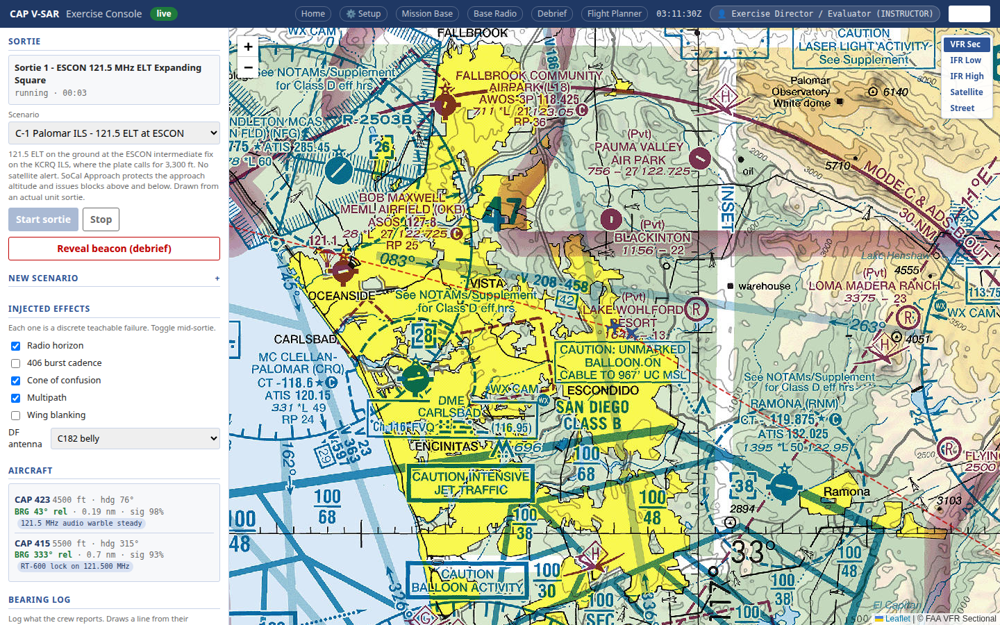
*Figure 19: Exercise Console (`/instructor`). Look at the `SORTIE` panel on the upper left showing `Sortie 1 - ESCON 121.5 MHz ELT Expanding Square` running on Scenario `C-1 Palomar ILS - 121.5 ELT at ESCON`, the `INJECTED EFFECTS` checkboxes (`Radio horizon`, `406 burst cadence`, `Cone of confusion`, `Multipath`, `Wing blanking`), the live `AIRCRAFT` telemetry readout showing what each aircraft's DF needle sees, and the `Reveal beacon (debrief)` button.*

* **What you will see:**
  * **SORTIE:** Scenario selector (`C-1 Palomar ILS - 121.5 ELT at ESCON`), **Start sortie** and **Stop** buttons, and the **Reveal beacon (debrief)** button.
  * **NEW SCENARIO (`+`):** Expandable form allowing the director to place a custom ELT anywhere on the chart by clicking the map, choose the frequency band (`121.5`, `243`, or `406`), and write the alert text given to Mission Base.
  * **INJECTED EFFECTS:** Five checkboxes that can be toggled on or off mid-flight without altering the saved scenario template:
    1. **Radio horizon:** Blocks the signal when the aircraft is below line-of-sight range for its altitude.
    2. **406 burst cadence:** Pulses 406 MHz beacons once every 50 seconds instead of transmitting continuously.
    3. **Cone of confusion:** Causes realistic needle swing when an aircraft passes nearly directly overhead the ELT (a `30°` cone above the beacon, roughly `0.35 NM` in radius at `4,500 ft MSL`).
    4. **Multipath:** Injects false reflected bearings off nearby ridges (such as the `40°` offset reflection off the Pauma Valley / Ramona hills) so crews and Mission Base must cross-check cuts.
    5. **Wing blanking:** Reduces signal strength by up to `24 dB` when a banked wing shields the belly DF antenna (`C182 belly` or `C182 top`).
  * **AIRCRAFT:** Displays each aircraft's altitude, heading, and—exclusively for the instructor—the exact relative bearing (`BRG`), distance (`nm`), and signal percentage (`sig %`) currently shown on that cockpit's DF head.
* **What you do:**
  1. Select **`C-1 Palomar ILS - 121.5 ELT at ESCON`** and click **Start sortie**.
  2. Begin with **Radio horizon** and **Cone of confusion** enabled.
  3. Once `CAP 423` establishes its expanding square over ESCON, toggle **Multipath** ON for one leg so Mission Base (`MRO 1` / `AOBD`) practices catching and rejecting a reflected cut that disagrees with `CAP 415`'s cross-bearing.
  4. When `CAP 423` passes within `0.2 NM` of ESCON (`sig 98%`) and `UDF 1` reaches the coordinates (`33.1700° N, 117.0792° W`) at **1842Z** to report the practice ELT located and switched off, click **Reveal beacon (debrief)** and then click **Stop**.
* **What good looks like:**
  * Clicking **Reveal beacon (debrief)** immediately uncovers the true ELT pin on every connected screen and unlocks full scoring on `/debrief`.
* **What to do if it doesn't work:**
  * If you start a sortie on a scenario whose beacon was already revealed in an earlier run with the same crew, a yellow warning banner will remind you that participants who saw the previous debrief already know the ELT location. Use **NEW SCENARIO (`+`)** to move the ELT pin a mile or two along the corridor for the second run.

---

## 10. Phase 7: Ground Team Verification and After-Action Debrief (`/debrief`)

### 10.1 Ground Team Homing (`UDF 1`)

Once Mission Base plots the converging lines of position from `CAP 423` (`078°` / `121°` true) and `CAP 415` (`285°` true) intersecting at the ESCON fix (`33.1700° N, 117.0792° W`), `MRO 1` vectors **`UDF 1`** along Highway 76 / Valley Center Road. Upon arrival at the access road beneath the approach corridor at **1842Z**, `UDF 1` performs a handheld directional antenna sweep, locates practice beacon **`EX-ESCON-1215`**, and reports over **Mission Net PRIMARY**:

> *"Mission Base, UDF 1, Exercise Traffic, practice ELT located at grid 33.1700 North, 117.0792 West near ESCON fix at 1842 Zulu, beacon secured, standing by for debrief, over."*

### 10.2 Conducting the After-Action Debrief (`/debrief`)

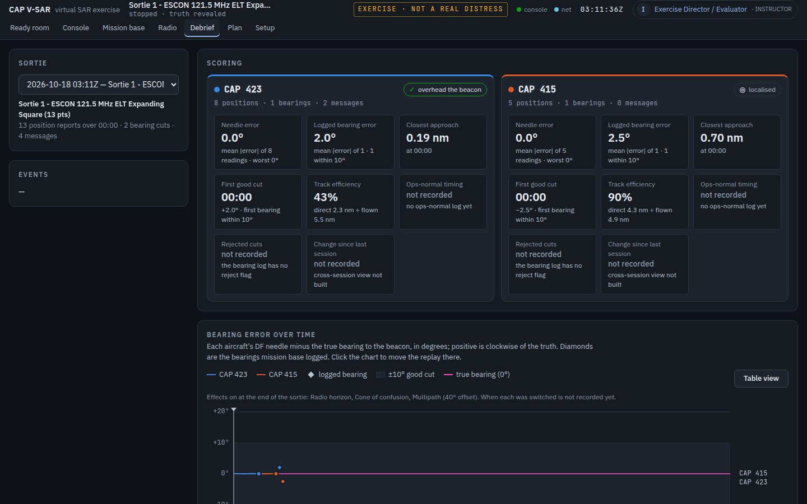
*Figure 20: Debrief Console (`/debrief`). Look at the `SORTIE` selector on the upper left, the `SCORING` cards for `CAP 423` (blue border, `overhead the beacon`, `2.0°` logged bearing error, `0.19 nm` closest approach) and `CAP 415` (orange border, `localised`, `2.5°` logged bearing error, `0.70 nm` closest approach, `90%` track efficiency), and the `BEARING ERROR OVER TIME` chart at the bottom.*

* **What you will see:**
  * **SORTIE Selector:** Choose any recorded sortie to replay its flight tracks, radio messages, and bearing cuts.
  * **SCORING Cards (One per Aircraft):**
    * **Outcome Pill:** Shows **`overhead the beacon`** (when the aircraft closed within `0.5 NM` of the ELT, as `CAP 423` did at `0.19 nm`) or **`localised`** (within `2 NM`, as `CAP 415` did at `0.70 nm`).
    * **Needle error:** Mean error between the cockpit DF needle and the true bearing to the beacon (shows how much multipath or wing blanking affected the instrument).
    * **Logged bearing error:** Mean error in degrees of the bearings the crew actually reported to Mission Base (`2.0°` for `CAP 423`; `2.5°` for `CAP 415`), plus how many cuts were within the `10°` good-cut band.
    * **Closest approach (CPA):** Minimum distance in nautical miles from the aircraft to the true ELT position (`0.19 nm` for `CAP 423`).
    * **First good cut:** Elapsed time from sortie start until the crew logged its first bearing within `10°` of truth.
    * **Track efficiency:** Direct distance divided by distance flown (`90%` for `CAP 415`'s direct cross-cut leg; `43%` for `CAP 423`'s multi-leg expanding square).
    * **Honest Placeholders (*Under development*):** `Ops-normal timing`, `Rejected cuts`, and `Change since last session` are explicitly labeled `not recorded` / `not built` so evaluators know which items still require manual **CAP Form 110** review.
  * **BEARING ERROR OVER TIME Chart:** Plots each aircraft's continuous DF needle error in degrees alongside diamond markers indicating each bearing logged by Mission Base against the shaded `10°` good-cut band. The **Replay** slider under the map scrubs the flight tracks to any moment of the sortie.
* **What you do:**
  1. Walk through each logged bearing diamond marker on the **BEARING ERROR OVER TIME** chart with the aircrews and Mission Base staff.
  2. Compare **Needle error** vs **Logged bearing error**: if the needle was deflected by multipath (`40°` offset) and the crew reported it without checking wings-level stability or cross-checking with Mission Base, discuss how to spot reflected cuts on future sorties.
  3. Have the **Skills Evaluation Trainer (SET)** review the crew's CPA (`0.19 nm`), bearing accuracy (`2.0°`), and **CAP Form 110** log discipline to credit demonstrated **SQTR** tasks per your wing's current procedures.

---

## 11. Capabilities Currently Under Development

In keeping with Civil Air Patrol training integrity, features that are planned or partially built are explicitly labeled in the screens and listed below so Exercise Directors do not plan a rehearsal around an unfinished capability:

| Area | Capability | Current Status | Workaround Today |
| :--- | :--- | :--- | :--- |
| **AI Mission Pilot** | **Cessna 182T (`CAP 487`) Automated Takeoff, Approach & Landing** | **Under development** (search pattern, cruise performance table, GFC 700 hand-over, and Ramona ridge terrain guard are flown and passing; runway takeoff/landing trials on the C182T are still in testing). | Start C182T AI-flown search sorties in the air at pattern entry, or have a human pilot fly the takeoff and landing (or use the C172SP profile for full airport-to-airport AI sorties). |
| **Exercise Setup (`/setup`)** | **Short 6-Character Badge Code Alias** | **Under development** (badged as not yet tracked in Step 1; full badge code or Google sign-in used). | Have participants sign in with Google at `/login`, scan the QR code, or copy/paste the full badge code. |
| **Exercise Setup (`/setup`)** | **Automated Server-Sent Email / SMS Dispatch** | **Under development** (badged `No server email sent · Use mailto or Copy Link` in Step 4). | Click **Email this invite** (which opens your email program with a pre-filled message) or click **Copy sign-in link**. |
| **Exercise Setup (`/setup`)** | **Single-Seat Session Revocation Without Saving Setup** | **Under development** (badged `Per-seat revoke without saving Setup: Not yet tracked` in Step 5). | Update or clear that seat's email in Step 2 and click **Save Roster & Seat Invites** in Step 3 (which revokes all participant sessions while keeping the Exercise Director signed in). |
| **Exercise Setup (`/setup`)** | **Custom Skills Evaluator (`SET`) Seat Provisioning** | **Under development** (shown as a dashed placeholder card in Step 2). | Have the SET share the Instructor console (`/instructor`) or open `/debrief` directly. |
| **Mission Base (`/base`)** | **Automated Pairwise LOP Intersection & Confidence Area** | **Under development** (lines of position are drawn on the map, but the intersection polygon is not computed automatically). | Visually inspect where the red dashed bearing lines cross on the chart to read off the target coordinates. |
| **Mission Base (`/base`)** | **Mid-Flight CalTopo Assignment Push / Retasking** | **Under development** (Phase 2 mapping integration). | Issue retasking coordinates verbally over the **Mission Base Radio** (`/radio`) and log them in **TASKING & MESSAGES**. |
| **Base Radio (`/radio`)** | **Simultaneous Airband SAR Net Audio in Live Headset View** | **Under development** (live voice net covers VHF-FM tactical channels; dual-watch IC-A120 airband face is in `/radio-legacy`). | Assign `MRO 2` or use the legacy dual-radio training view (`/radio-legacy`) when practicing VHF-AM airband logging. |
| **Debrief (`/debrief`)** | **Automated Ops-Normal Timing, Rejected-Cut Flag & Multi-Session Trend** | **Under development** (cards explicitly display `not recorded` / `not built`). | Review the exported **CAP Form 110** log for 30-minute Ops Normal timing and compare saved sortie summaries across sessions. |

---

## 12. Appendix A: Technical Staff Setup and System Administration

*This appendix is intended for the squadron or wing technical staff member who starts the simulator computers and exercise server before the briefing. Volunteers participating in the exercise do not need this section.*

### A.1 How the System Pieces Fit Together

1. **Exercise Console and Mission Base Server (`services/exercise`):**
   * Runs on the host computer (in the lab deployment, host `ms01` at `https://192.0.2.151` or locally on `http://127.0.0.1:8700`) and stores exercise rosters, seat email assignments, scenarios, aircraft tracks, bearings, and radio logs in a local database file (`CAPVSAR_DB`, default `/data/exercise.db`).
2. **Voice Radio Server (`capvsar-mumble`):**
   * Runs a Mumble voice server on port `64738` (TCP/UDP) with pre-built channels (`Briefing Room`, `Mission Base`, `Mission Net PRIMARY`, `Mission Net ALTERNATE`, `Aircraft / CAP-1..3 Intercom`, and `Instructor - SET`).
3. **Flight Simulator Station (`X-Plane 12` + `XPPython3`):**
   * Runs X-Plane 12 with the `PI_capvsar_df.py` script installed under `Resources/plugins/PythonPlugins/`. This script calculates line-of-sight terrain masking, radio horizon, 406 MHz burst timing, cone of confusion, and wing blanking from real simulator terrain and sends the aircraft's position to the Exercise Console every few seconds using the station's `capvsar_station.ini` file (`CONSOLE`, `CALLSIGN`, `PLUGIN_KEY`).
4. **Mission Observer Instrument Panel (`Air Manager 4.2+`):**
   * Runs the four custom CAP V-SAR instruments (**Becker SAR-DF 517**, **RHOTHETA RT-600**, **Technisonic TDFM-136B**, and **Garmin GMA 1347**) plus the **Mission Master Switch** and **Circuit Breaker Panel**, bundled together as the `cap-c182t-mo-station` panel.

### A.2 Starting the Exercise Console Locally for a Training Session

From a terminal on the Linux workstation, in the repository's top-level directory, start the Exercise Console service using the Python virtual environment:

```bash
PYTHONPATH=.:services/exercise \
  CAPVSAR_DB=/tmp/capvsar_exercise.db \
  CAPVSAR_DEV_OPEN=1 \
  ~/.venvs/onb/bin/uvicorn app.main:app \
  --app-dir services/exercise \
  --host 0.0.0.0 --port 8700
```

* Once started, open `http://127.0.0.1:8700/setup` (or `https://<server-ip>/setup` when fronted by the local HTTPS proxy) to configure the exercise, enter seat emails, and print backup badges.
* When `CAPVSAR_DEV_OPEN=1` is omitted (standard multi-station exercise mode), the Exercise Console requires sign-in (via Google or badge code) for every station and automatically prints the initial `INSTR-1-...` bootstrap badge code to the server log on first start.

### A.3 Installing or Updating the Simulator and Air Manager Panels

```bash
# 1. Install the direction-finding and station reporting script into X-Plane 12:
python3 scripts/deploy_xplane_plugin.py

# 2. Install the four DF/radio instruments into Air Manager 4.2+:
python3 scripts/deploy_df_instruments.py

# 3. Install or package the Cessna 182T Mission Observer panel:
python3 scripts/deploy_mo_panel.py
```

### A.4 Setting Up Sign-In with Google (Plain-Language Guide for Server Operators)

When you configure Google sign-in on the exercise server, anyone whose email address the Exercise Director enters in `/setup` Step 2 can click **Sign in with Google** at `/login` and land straight on their seat's screen. Badge codes keep working at all times and serve as the offline fallback when the site has no internet.

#### Step 1 — Get a Client ID and Client Secret from Google (One-Time Setup)

1. In the **Google Cloud Console**, open **APIs & Services -> Credentials** for a project you control.
2. If Google asks you to configure the **OAuth consent screen** first, choose **External**, fill in the application name (for example, `CAP V-SAR Exercise Console`) and your support email address, and keep the standard `email` permission (no extra permissions are needed).
3. Click **Create credentials -> OAuth client ID -> Web application**.
4. Under **Authorized redirect URIs**, add your console's public HTTPS callback address:
   * `https://<your-console-host>/auth/oidc/callback` (for example, `https://vsar.example.org/auth/oidc/callback`).
   * The host name must match the public `https://` web address participants use in their browser. Leave **Authorized JavaScript origins** empty.
5. Copy the **Client ID** and **Client secret** that Google displays.
   * *(If your wing runs its own sign-in portal such as **authentik** instead of Google directly, create an application provider there with the same callback URI and copy its issuer URL, Client ID, and Client secret.)*

#### Step 2 — Paste the Settings into `.env` on the Server

Open the `.env` file on the exercise server (next to the other console settings—**never commit real secrets to git**) and paste:

```ini
CAPVSAR_OIDC_ISSUER=https://accounts.google.com
CAPVSAR_OIDC_CLIENT_ID=<paste your Google Client ID here>
CAPVSAR_OIDC_CLIENT_SECRET=<paste your Google Client secret here>
CAPVSAR_OIDC_REDIRECT_BASE=https://<your-console-host>
CAPVSAR_TRUST_PROXY=1
```

Optional settings you can also add to `.env`:

* `CAPVSAR_OIDC_DIRECTOR_EMAILS=director@example.org,deputy@example.org` — comma-separated Google addresses that always sign in as Exercise Director (`INSTR-1`), even before any exercise has been set up in `/setup`.
* `CAPVSAR_OIDC_HD=<your wing's Google Workspace domain>` — only accept Google accounts belonging to that Google Workspace domain (leave unset when members use personal Google accounts).
* `CAPVSAR_OIDC_LABEL=Sign in with CAP account` — customize the wording on the sign-in button at `/login`.
* `CAPVSAR_SESSION_LIFETIME_S=43200` — how long a sign-in lasts in seconds (default is 24 hours / `86400`, applying to both Google and badge sign-ins).

#### Step 3 — Restart the Console and Test

1. Restart the exercise service (`docker compose up -d exercise` or your deployment script) so it reads the new `.env` settings at startup.
2. Open `/login` in your browser: the **Sign in with Google** button now appears above the badge code form.
3. Click **Sign in with Google** using an email address listed in `CAPVSAR_OIDC_DIRECTOR_EMAILS` (or assigned to the Exercise Director seat in `/setup`). You will land on the console with the director menu, and your identity chip in the top bar will show `· Google`.
4. **Seat email rules & invite emails:**
   * Seat email addresses must use plain ASCII characters (letters, digits, `.`, `_`, `-`, `+`, `@`); accented or non-Latin addresses are refused in `/setup` (hand that participant a badge code instead).
   * Clicking **Email this invite** in `/setup` Step 4 opens a `mailto:` draft in the director's mail program: for a seat assigned by email, it sends **only** the `/login` sign-in page address plus the seat/role and callsign in plain words (**no badge code and no `/join/` link**); for a badge-only seat, it sends the badge link and badge code as before; and for the Exercise Director seat, it **never** includes the director's badge code.
   * Signing in again from a browser that is already signed in (via Google or badge, any seat) ends and replaces that browser's previous session without affecting other devices signed into the same seat.
5. **Offline behavior:** If the four required `CAPVSAR_OIDC_*` variables are omitted in `.env`, the Google button is hidden on `/login` and the console runs in badge-only mode. If the settings are present but internet access to Google drops during an exercise, clicking the Google button displays a plain-language message with a link back to the badge code form, while everyone already signed in stays signed in.
6. **Detailed Technical Reference:** For full technical and security notes (including authentik issuer paths, browser-bound sign-in state cookies, `[redacted]` callback query parameters in access logs, per-minute rate limiting after 10 failed attempts, and the one-command `X-Forwarded-For` proxy check), see the operator guide at `/tmp/cap-vsar-oidc/OPERATOR.md`.
